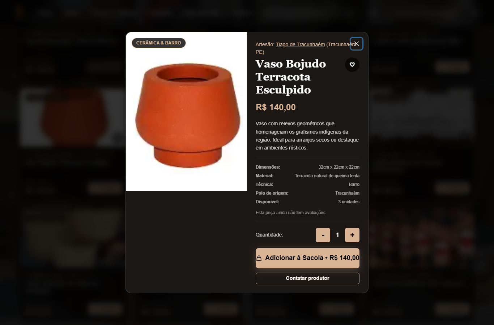
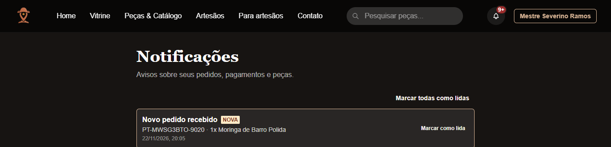

# Evidências da Avaliação 2

Este documento reúne as evidências pedidas nos "Entregáveis da Avaliação 2" e diz onde está cada um dos itens da lista. As evidências abaixo foram coletadas em **22/11/2026**, em ambiente local (Windows 11, PostgreSQL 16 e Redis 7 em Docker, API, worker de filas e site rodando), com o código da branch `integracao-backend` já com a `juliana-backend` incorporada.

## Situação de cada entregável

| Entregável | Onde está | Situação |
|---|---|---|
| Repositório GitHub final | [github.com/comparoto/Ponto-da-Terra](https://github.com/comparoto/Ponto-da-Terra), branch `integracao-backend` ([README](../README.md)) | Frontend, backend e instruções de execução. Ainda não está na `main` |
| Deploy final | [Site](https://ponto-da-terra-eight.vercel.app) · [API](https://ponto-da-terra-api.vercel.app/api/health) ([DEPLOY_VERCEL.md](DEPLOY_VERCEL.md)) | No ar. A versão publicada **não tem** o código da recomendação, que só existe no repositório até o próximo deploy |
| Vídeo ou screencast | Link do README (1ª entrega) | **Pendente:** é preciso gravar um novo, com o *Network* do navegador aberto |
| Documentação da API | [Swagger](https://ponto-da-terra-api.vercel.app/api/docs) · [backend/README.md](../backend/README.md) | 69 operações em 60 caminhos, com teste de contrato que compara as respostas com a documentação |
| README atualizado | [README.md](../README.md) | Arquitetura, execução, tecnologias e deploy |
| `.env.example` | [.env.example](../.env.example) e [backend/.env.example](../backend/.env.example) | Só valores de exemplo; tokens e chaves ficam vazios |
| Evidência de banco de dados | [Seção 1](#1-evidência-de-banco-de-dados) | Abaixo |
| Evidência de recomendação | [Seção 2](#2-evidência-de-recomendação) | Abaixo |
| Evidência de assíncrono | [Seção 3](#3-evidência-de-assíncrono) | Abaixo |
| Evidência de cache | [Seção 4](#4-evidência-de-cache) | Abaixo |

Também vale mostrar no screencast as quatro evidências abaixo funcionando, com o *Network* aberto.

---

## 1. Evidência de banco de dados

**Banco:** PostgreSQL 16, acessado pelo Prisma 7. Em produção é o Neon. O modelo tem 24 tabelas, descritas em [DIAGRAMA_DE_CLASSES.md](DIAGRAMA_DE_CLASSES.md), com 7 migrations versionadas em `backend/prisma/migrations`.

**Persistência real.** Foi feita uma compra pela API (checkout e pagamento por PIX), os dados foram consultados no banco, o **contêiner do PostgreSQL foi reiniciado** e a mesma consulta foi repetida.

Contagem de linhas antes do reinício (consulta direta no banco):

| Tabela | Linhas |
|---|---|
| Usuario | 8 |
| Artesao | 6 |
| Produto | 15 |
| Compra | 2 |
| Pedido | 2 |
| Pagamento | 2 |
| NotificacaoLog | 20 |
| EventoOutbox | 33 |

A compra `PT-MWSG3BTO-9020`, antes e depois do reinício do banco:

```
$ docker exec ponto-da-terra-postgres psql -U pdt -d pontodaterra -c "SELECT c.codigo, c.status, pg.metodo, pg.status, p.status, p."valorTotal" FROM "Compra" c JOIN "Pagamento" pg ON ... JOIN "Pedido" p ON ... WHERE c.codigo='PT-MWSG3BTO-9020';"

ANTES    codigo: PT-MWSG3BTO-9020 | compra: AGUARDANDO_PAGAMENTO | metodo: PIX | pagamento: PENDENTE | pedido: AGUARDANDO_PAGAMENTO | valorTotal: 107.90
         (contêiner reiniciado em 2026-11-22T23:06:02Z)
DEPOIS   codigo: PT-MWSG3BTO-9020 | compra: AGUARDANDO_PAGAMENTO | metodo: PIX | pagamento: PENDENTE | pedido: AGUARDANDO_PAGAMENTO | valorTotal: 107.90
```

Os dados continuam depois do reinício, porque estão gravados no volume do PostgreSQL e não na memória da API. Em produção, a persistência vem do Neon.

**Como repetir:** `cd backend && npm run db:up && npm run db:migrate && npm run db:seed`, depois `npm run db:studio` para ver as tabelas.

---

## 2. Evidência de recomendação

**O que é.** A seção **"Feitas para você"** da página inicial sugere peças a partir do que o comprador **visualizou** e **favoritou**. Código: [`src/services/recomendacaoService.ts`](../src/services/recomendacaoService.ts), usado em [`src/app/home/page.tsx`](../src/app/home/page.tsx).

**Como funciona (conforme o código):**
- Cada peça aberta no detalhe (modal) entra no histórico de visualização, guardado no `localStorage` do navegador (até 20 peças).
- Cada peça candidata recebe uma pontuação em relação às peças já vistas e às favoritas: **categoria** vale 4, **técnica** 3, **polo de origem** 2 e **mesmo artesão** 1. As vistas mais recentes pesam mais que as antigas, e os favoritos pesam 1,5.
- Peças já vistas, favoritas ou que já aparecem nos destaques não são sugeridas. As 4 de maior pontuação são exibidas.
- Sem nenhuma afinidade, a seção mostra as peças restantes do catálogo, na ordem original.

**Limites, para falar com clareza:** o cálculo é feito **no navegador**, sobre as peças carregadas da API, e o histórico fica só naquele navegador. É uma recomendação por regras de similaridade, **não usa IA nem aprendizado de máquina**.

**Evidência (comprador de demonstração, navegador novo):**
1. Antes de ver qualquer peça, a seção mostra a ordem padrão do catálogo.
2. O comprador abre a peça **Vaso Bojudo Terracota Esculpido** (técnica: barro, polo: Tracunhaém):

   

3. O histórico registrado no navegador passou a conter o identificador dessa peça (`ponto-da-terra:pecas-visualizadas`).
4. De volta à página inicial, as quatro peças recomendadas são **todas da mesma técnica (barro)** que a peça vista:

   

   Recomendadas: *Painel Decorativo Floral em Terracota*, *Moringa de Barro Polida*, *Trio Nordestino em Barro Figurativo* e *Pote Tradicional de Barro com Tampa*.

**Como repetir:** `cd e2e && FRONT_URL=http://localhost:3002 node evidencias-avaliacao-2.cjs` (com API, worker e site rodando). O roteiro também gera as capturas em `docs/evidencias/`.

---

## 3. Evidência de assíncrono

**O que é.** Quando um comprador faz um pedido, o aviso ao artesão **não é gerado dentro da requisição**: ele passa por uma fila e é processado por um processo separado, o worker.

**Fluxo ([backend/README.md](../backend/README.md)):**
1. O checkout grava a compra, os pedidos e um registro em `EventoOutbox` **na mesma transação do banco** (padrão Transactional Outbox). Se a transação falhar, não sobra evento solto.
2. Um *relay* publica os eventos pendentes na fila (BullMQ com Redis localmente; QStash na Vercel).
3. O **worker** consome o evento e grava a notificação em `NotificacaoLog`. O consumo é **idempotente**: o `eventoId` é único, então um evento repetido não gera notificação duplicada.
4. O artesão vê a notificação na tela, com o contador no sino.

Também passam pela fila a expiração de PIX e boleto vencidos (devolvendo o estoque) e o processamento de imagens enviadas.

**Evidência.** O comprador de demonstração comprou 1× *Moringa de Barro Polida* (PIX). A API respondeu ao checkout sem esperar o worker. Segundos depois:

Log do worker:
```
[worker] 1 evento(s) publicados na fila
[worker] NOVO_PEDIDO processado (evento e2866abf-2a0f-4df0-a6be-4239670e097e)
```

Banco, ligando o evento à notificação (consulta pelo código da compra `PT-MWSG3BTO-9020`):
```
eventoId                             | tipoEvento  | enviadoComSucesso | tipo (outbox) | publicado
e2866abf-2a0f-4df0-a6be-4239670e097e | NOVO_PEDIDO | t                 | NOVO_PEDIDO   | t
```

A conta do artesão (Mestre Severino Ramos) passou de 19 para 20 notificações, e a nova aparece no topo, com o contador de não lidas no sino:



**Como repetir:** subir API e worker (`npm run dev` e `npm run dev:worker`, em `backend/`) e rodar `node evidencias-avaliacao-2.cjs` em `e2e/`. Sem o worker, a API funciona, mas os avisos não são gerados (veja o README do backend).

---

## 4. Evidência de cache

**Onde foi aplicado.** No **catálogo da vitrine** (`GET /api/produtos`, em [`produtos.service.ts`](../backend/src/modules/produtos/produtos.service.ts)), nas **categorias** e nas **páginas de artesãos** (lista e perfil público, em `artesaos.routes.ts`). Cache no **Redis** (Upstash em produção).

**Por que.** A vitrine é a página mais acessada e a consulta é cara: junta peças, artesões, categorias e estoque, com filtros e paginação. O catálogo muda pouco em relação à frequência de leitura, então vale guardar a resposta.

**Como funciona ([`shared/cache.ts`](../backend/src/shared/cache.ts)):**
- A chave depende da consulta feita (filtros, página, ordenação).
- O tempo de vida é de **60 segundos** (`CACHE_TTL_SECONDS`).
- **Invalidação por versão:** qualquer mudança que afete a vitrine (aprovação ou reprovação na curadoria, edição de peça, mudança de estoque por compra ou por devolução, alterações de conta de artesão) aumenta o número da versão no Redis. As chaves antigas deixam de ser lidas e expiram sozinhas.
- Se o Redis falhar, a API responde direto do banco, sem cache.
- A resposta traz o cabeçalho **`X-Cache: HIT`** (veio do cache) ou **`MISS`** (veio do banco). Primeiras requisições nesta coleta: `MISS`, depois `HIT`.

**Medição.** 50 usuários simultâneos por 15 s em cada cenário, com o script [`vitrine-cache.mjs`](../backend/tests/carga/vitrine-cache.mjs):

| Cenário | Requisições | Por segundo | Mediana | p95 | Erros |
|---|---|---|---|---|---|
| **Com cache** (mesma consulta, `HIT`) | 2.176 | 145 | 301 ms | 394 ms | 0 |
| **Sem cache** (consulta diferente a cada vez, `MISS`) | 400 | 27 | 2.019 ms | 2.250 ms | 0 |

Com cache, a API atendeu **cerca de 5 vezes mais requisições por segundo** e com **mediana cerca de 7 vezes menor**. Das 2.176 respostas do cenário com cache, 2.126 foram `HIT` e 50 foram `MISS` (as primeiras, antes de o cache ser preenchido).

**Limites desta medição, para falar com clareza:**
- Foi feita numa máquina de desenvolvimento, com outras aplicações abertas e o banco em Docker. Vale como **comparação entre os dois cenários**, não como capacidade de produção.
- Os valores absolutos ficaram abaixo dos medidos em 11/11/2026 e registrados no [RELATORIO_TESTES.md](RELATORIO_TESTES.md) (naquela data, com cache: 282 req/s e mediana de 158 ms; sem cache: 152 req/s e mediana de 298 ms). Não investiguei a causa da diferença. A comparação (o cache é bem mais rápido) se mantém nas duas medições.
- A versão do mesmo teste em **k6 via Docker**, rodada hoje nesta máquina, **reprovou nos limites** em duas execuções (tempos altos e algumas falhas com 50 usuários simultâneos; na 1ª, as falhas foram erros 500 por tempo esgotado de transação no banco). Uma medição direta com Node, no mesmo momento, não teve nenhum erro. O k6 em Docker no Windows pode estar limitado por essa máquina. Não repeti em outra.

**Como repetir:** com a API rodando, `cd backend && node tests/carga/vitrine-cache.mjs`. Versão em k6: `npm run test:carga:vitrine`.
