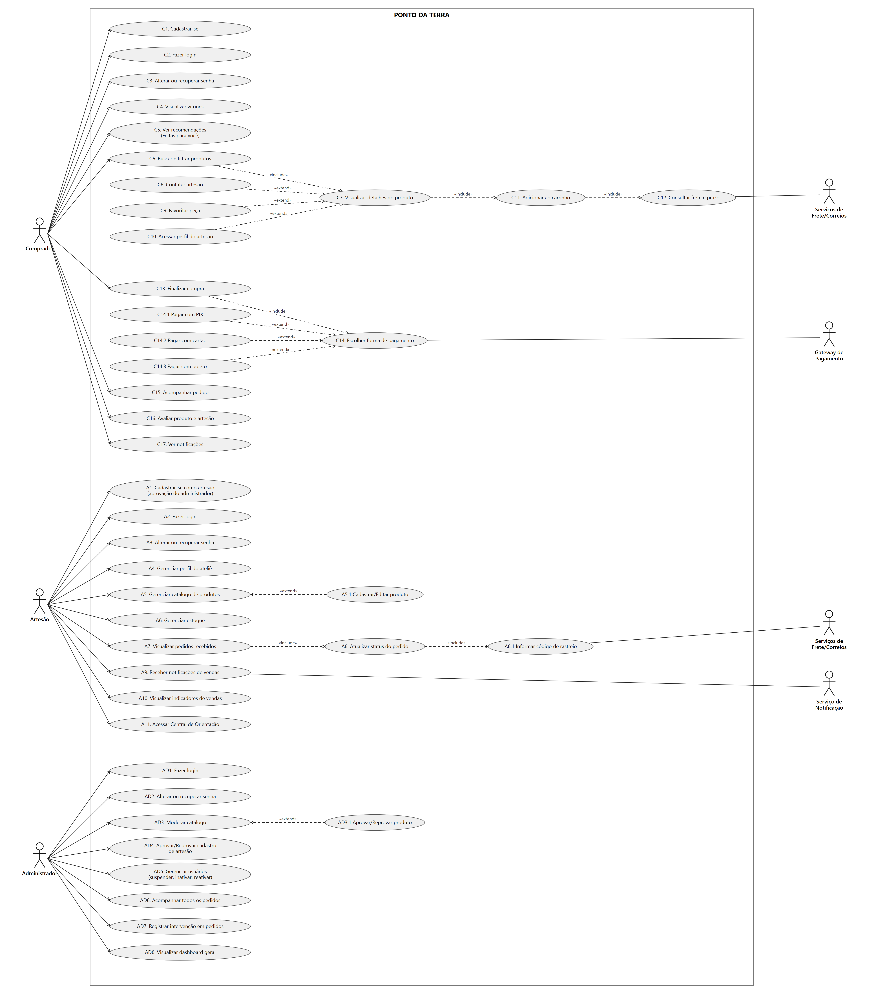

# Diagrama de casos de uso (atualizado)

Este diagrama atualiza o diagrama de casos de uso da 1ª unidade com tudo o que foi implementado na integração com o backend. Ele mantém a estrutura do original (atores, `include`, `extend` e os atores externos) e acrescenta os casos que surgiram depois.



Versão com os casos novos destacados em verde: [`casos-de-uso-com-novidades-destacadas.png`](../diagramas/casos-de-uso-com-novidades-destacadas.png). Versão editável (vetorial): [`casos-de-uso.svg`](../diagramas/casos-de-uso.svg).

**Como ler**
- Cada ator tem o seu bloco, com a numeração própria: **C** (comprador), **A** (artesão) e **AD** (administrador).
- A seta tracejada `«include»` vai do caso que **precisa** de outro para o caso incluído. A seta `«extend»` vai da extensão para o caso base.
- Os atores à direita são externos ao sistema: Serviços de Frete/Correios, Gateway de Pagamento e Serviço de Notificação. O frete e o pagamento são **simulados** (restrição de escopo do projeto).
- O ator "Serviços de Frete/Correios" aparece duas vezes (ao lado do bloco do comprador e do artesão) só para as linhas não se cruzarem. É o mesmo ator.
- "Fazer login" e "Alterar ou recuperar senha" aparecem uma vez em cada bloco, porque os três perfis têm essas funções.

## Casos de uso e histórias de usuário

"Novo" indica o que **não estava** no diagrama da 1ª unidade. As histórias (HU) estão em [REQUISITOS_BACKEND.md](REQUISITOS_BACKEND.md).

### Comprador

| Caso de uso | História | Novo |
|---|---|---|
| C1 Cadastrar-se | Conta | |
| C2 Fazer login | Conta | |
| C3 Alterar ou recuperar senha | Conta | Sim |
| C4 Visualizar vitrines | HU2 | |
| C5 Ver recomendações ("Feitas para você") | Extra | Sim |
| C6 Buscar e filtrar produtos | HU2 | |
| C7 Visualizar detalhes do produto | HU2 | |
| C8 Contatar artesão | HU14 | |
| C9 Favoritar peça | Extra | Sim |
| C10 Acessar perfil do artesão | HU3 | Sim |
| C11 Adicionar ao carrinho | HU4 e HU11 | |
| C12 Consultar frete e prazo | HU4 | |
| C13 Finalizar compra | HU11 | |
| C14 Escolher forma de pagamento (PIX, cartão, boleto) | HU5 | |
| C15 Acompanhar pedido | HU6 | |
| C16 Avaliar produto e artesão | HU17 | |
| C17 Ver notificações | HU12 | Sim |

### Artesão

| Caso de uso | História | Novo |
|---|---|---|
| A1 Cadastrar-se como artesão (aprovação do administrador) | HU8 | Sim |
| A2 Fazer login | Conta | |
| A3 Alterar ou recuperar senha | Conta | Sim |
| A4 Gerenciar perfil do ateliê | HU7 | Sim |
| A5 Gerenciar catálogo de produtos (A5.1 Cadastrar/Editar produto) | HU1 | |
| A6 Gerenciar estoque | HU1 | |
| A7 Visualizar pedidos recebidos | HU13 | |
| A8 Atualizar status do pedido (A8.1 Informar código de rastreio) | HU13 | |
| A9 Receber notificações de vendas | HU12 | |
| A10 Visualizar indicadores de vendas | HU18 | Sim |
| A11 Acessar Central de Orientação | HU15 | |

### Administrador

| Caso de uso | História | Novo |
|---|---|---|
| AD1 Fazer login | Conta | |
| AD2 Alterar ou recuperar senha | Conta | Sim |
| AD3 Moderar catálogo (AD3.1 Aprovar/Reprovar produto) | HU8 | |
| AD4 Aprovar/Reprovar cadastro de artesão | HU8 | Sim |
| AD5 Gerenciar usuários (suspender, inativar, reativar) | HU16 | |
| AD6 Acompanhar todos os pedidos | HU10 | |
| AD7 Registrar intervenção em pedidos | HU10 | |
| AD8 Visualizar dashboard geral | HU9 | |

## Diferenças em relação ao diagrama da 1ª unidade

- **Casos novos (9):** alterar ou recuperar senha (nos três perfis), recomendações, favoritar peça, acessar o perfil do artesão, ver notificações, cadastro de artesão com aprovação, perfil do ateliê, indicadores de vendas e aprovação do cadastro de artesão.
- **Reorganização:** a numeração agora é por ator e sem repetições. Antes, números como "5" apareciam em mais de um ator.
- **Ajuste de nome:** "Gerenciar usuários / Suspender" passou a "Gerenciar usuários (suspender, inativar, reativar)", porque o estado `INATIVO` foi criado na implementação.
- **Mantido:** todos os casos originais, com os mesmos `include` e `extend`.

## Como gerar de novo

```bash
cd e2e && node gerar-diagrama-casos-de-uso.cjs
```

O roteiro desenha o diagrama a partir da lista de casos que está no próprio arquivo (`e2e/gerar-diagrama-casos-de-uso.cjs`). Para acrescentar ou mudar um caso, edite essa lista e rode o comando. O diagrama de classes é descrito em [DIAGRAMA_DE_CLASSES.md](DIAGRAMA_DE_CLASSES.md).
