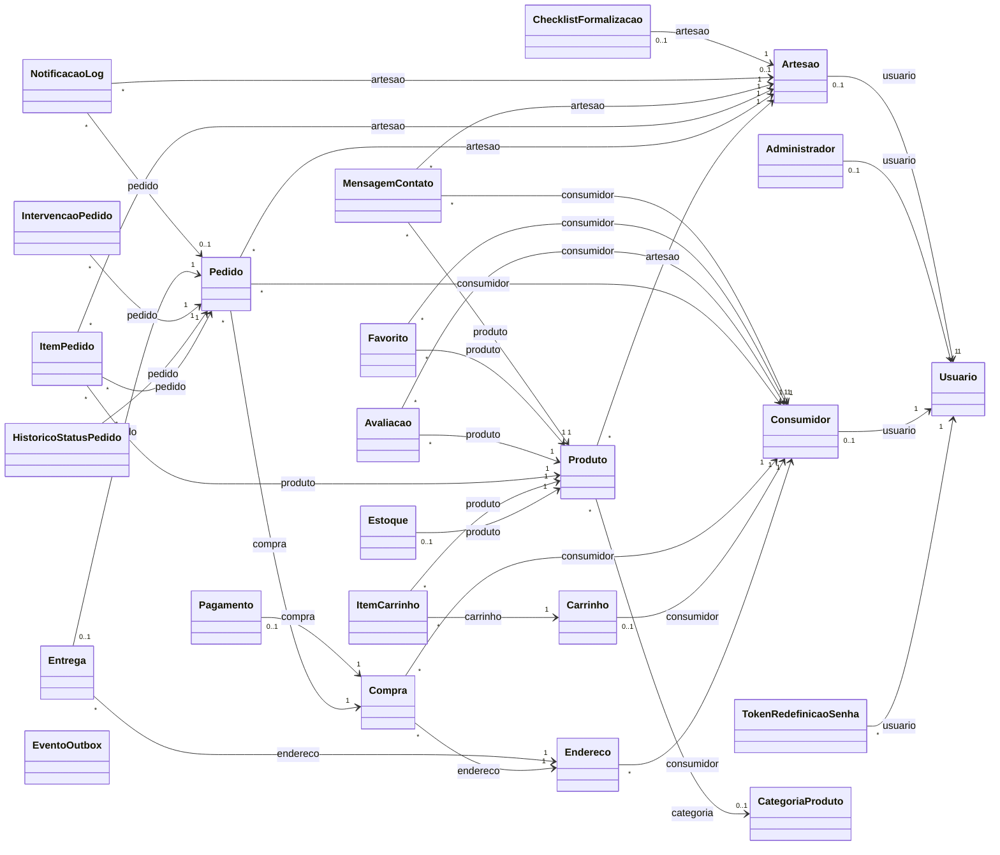
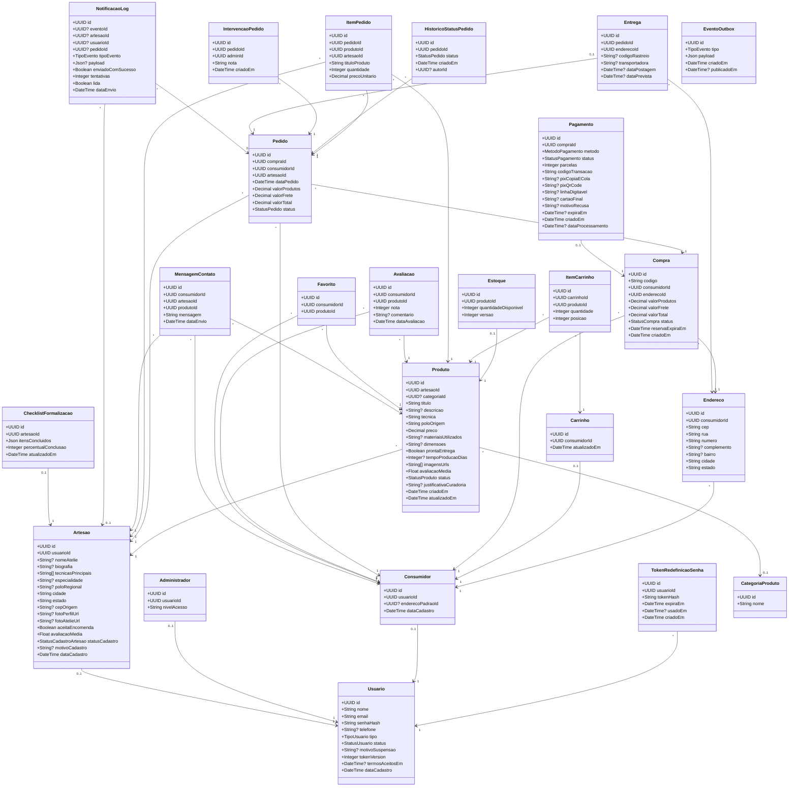
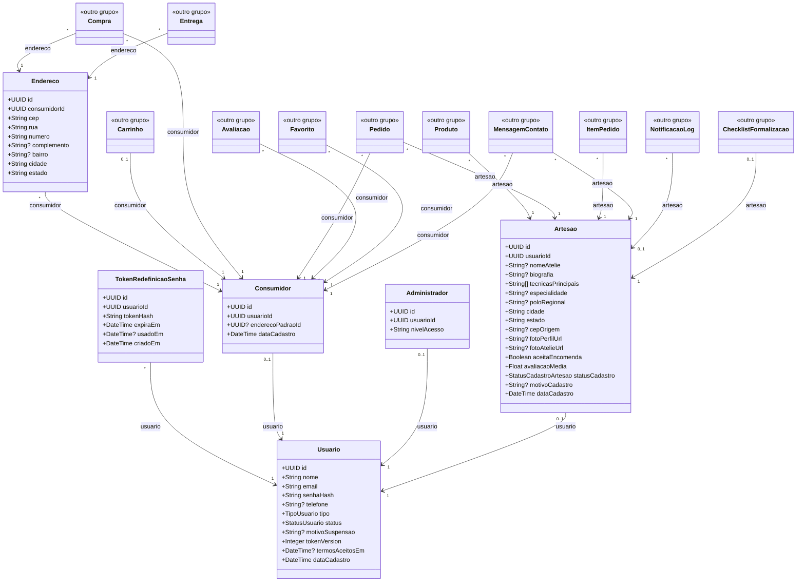
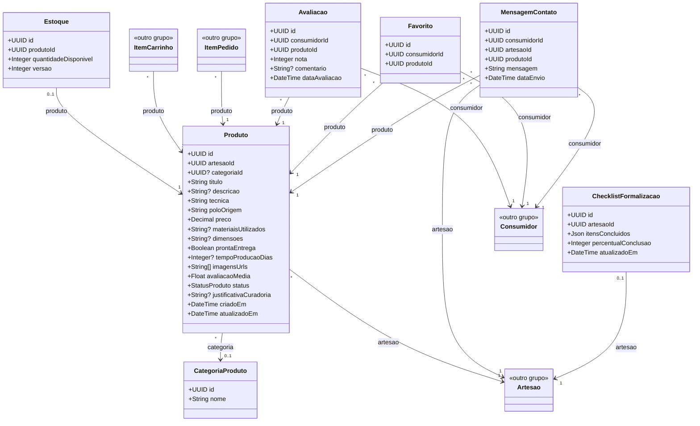
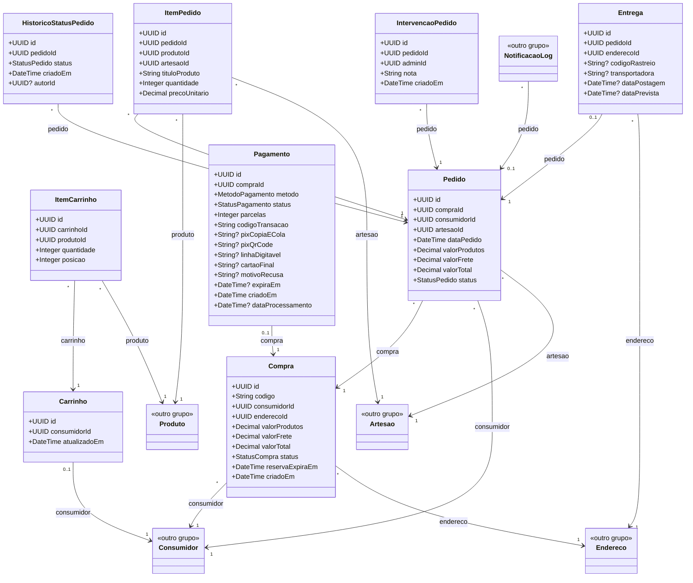
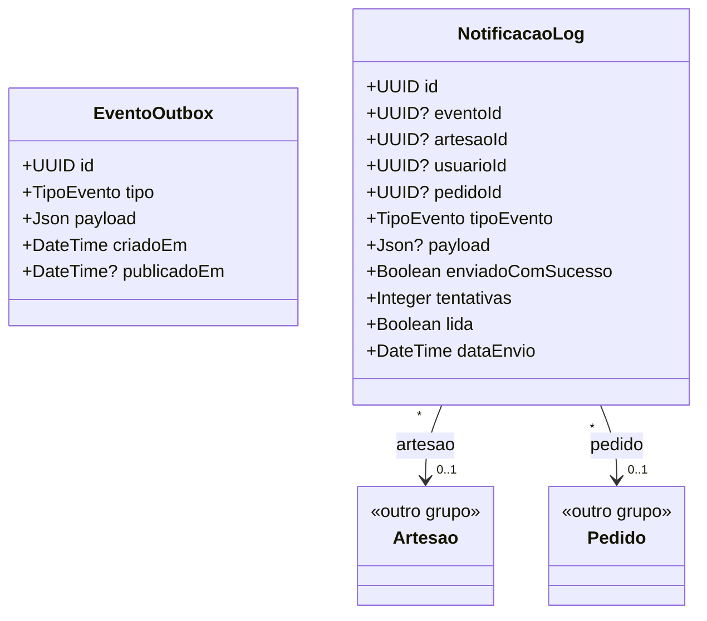

# Diagrama de classes do modelo de dados

> **Arquivo gerado automaticamente** a partir de `backend/prisma/schema.prisma` (`cd backend && npm run docs:diagrama`). Não edite à mão: mude o schema e gere de novo.

Este diagrama mostra o modelo de dados **como está implementado** (24 classes e 9 enumerações). Ele atualiza o diagrama de classes da 1ª unidade com os ajustes que a implementação exigiu: a tabela "Ajustes em relação ao diagrama da 1ª unidade", mais abaixo, vem dos comentários `AJUSTE` do próprio schema e se liga aos conflitos C2, C3, C8 e C9 do [documento de requisitos](REQUISITOS_BACKEND.md) (seção 5).

**Como ler:** `*` = muitos, `1` = exatamente um, `0..1` = opcional. A seta sai da classe que guarda a chave estrangeira. O rótulo é o nome do campo de relação.

## Visão geral

## Diagrama completo

Todas as classes com seus atributos e todas as relações (sem rótulos nas setas, para o desenho ficar limpo; o campo de ligação aparece nos atributos, como `pedidoId`). A imagem desta versão, para colar em documentos, é gerada por `node e2e/gerar-imagens-diagrama.cjs` (arquivos em [`docs/diagramas/`](../diagramas)).

## Pessoas e contas

Usuário e os perfis comprador, artesão e administrador, com endereços e recuperação de senha.

## Catálogo e relacionamento com o comprador

Peças, estoque, categorias, favoritos, avaliações, mensagens ao produtor e checklist de formalização do artesão.

## Compra, pagamento e pedidos

Carrinho, a compra (um pagamento) dividida em um pedido por artesão, entrega, histórico e intervenções do admin.

## Fila de eventos e notificações

Transactional Outbox (eventos gravados junto com a operação) e o registro das notificações.

## Enumerações

| Enumeração | Valores |
|---|---|
| `TipoUsuario` | `ADMIN`, `ARTESAO`, `CONSUMIDOR` |
| `StatusUsuario` | `ATIVO`, `INATIVO`, `SUSPENSO` |
| `StatusCadastroArtesao` | `PENDENTE`, `APROVADO`, `REJEITADO` |
| `StatusProduto` | `PENDENTE`, `ATIVO`, `REJEITADO` |
| `StatusPedido` | `CRIADO`, `AGUARDANDO_PAGAMENTO`, `PAGO`, `EM_PRODUCAO`, `DESPACHADO`, `ENTREGUE`, `CANCELADO` |
| `MetodoPagamento` | `PIX`, `CARTAO`, `BOLETO` |
| `StatusCompra` | `AGUARDANDO_PAGAMENTO`, `PAGA`, `CANCELADA` |
| `StatusPagamento` | `PENDENTE`, `APROVADO`, `RECUSADO`, `EXPIRADO` |
| `TipoEvento` | `NOVO_PEDIDO`, `PRODUTO_APROVADO`, `PRODUTO_REJEITADO`, `NOVA_MENSAGEM`, `PEDIDO_ATUALIZADO`, `CADASTRO_APROVADO`, `CADASTRO_REJEITADO`, `IMAGEM_ENVIADA` |

## Ajustes em relação ao diagrama da 1ª unidade

Vêm dos comentários `AJUSTE` do schema. Os códigos C2, C3, C8, C9 e D5 referem-se ao quadro de conflitos e decisões do [documento de requisitos](REQUISITOS_BACKEND.md).

| Onde | Ajuste |
|---|---|
| `Usuario.tokenVersion` | incrementado no logout/suspensão para invalidar tokens emitidos (HU16) |
| `Artesao.especialidade` | usado pelo frontend atual |
| `Artesao.poloRegional` | polo regional de atuação (ex.: "Alto do Moura", "Agreste") — HU7 |
| `Produto.tecnica` | C3: obrigatório (HU1/HU2/TC09) |
| `Produto.poloOrigem` | C3: obrigatório (HU1/HU2/TC09) |
| `Produto.dimensoes` | usado pelo frontend atual |
| `Compra` | C9/D5: o checkout gera uma Compra (um pagamento) dividida em um Pedido por artesão. |
| `Pedido.compraId` | C9: compra (checkout) a que este pedido pertence |
| `Pedido.artesaoId` | C9 |
| `HistoricoStatusPedido` | linha do tempo do pedido (HU6) |
| `IntervencaoPedido` | substitui Pedido.notasIntervencaoAdmin (HU10) |
| `Pagamento.compraId` | o pagamento é da compra (não de cada pedido) |
| `NotificacaoLog.eventoId` | evento da outbox que originou a notificação (garante processamento único pelo worker) |
| `NotificacaoLog.usuarioId` | destinatário genérico (ex.: consumidor) |
| `EventoOutbox` | Transactional Outbox — o evento é gravado na mesma transação da operação |
| `enum StatusUsuario` | C8: + INATIVO (HU16) |
| `enum StatusPedido` | C2: + CANCELADO (TC16) |
| `enum StatusCompra` | status da compra (checkout) — agrupa os pedidos de vários artesãos com um único pagamento |
| `enum StatusPagamento` | + EXPIRADO (TC16) |

## Descrição das classes (do schema)

| Classe | Descrição |
|---|---|
| `TokenRedefinicaoSenha` | Link de "esqueci minha senha": guarda só o hash do token (o token em si vai apenas no e-mail) |
| `Compra` | AJUSTE C9/D5: o checkout gera uma Compra (um pagamento) dividida em um Pedido por artesão. |
| `HistoricoStatusPedido` | AJUSTE: linha do tempo do pedido (HU6) |
| `IntervencaoPedido` | AJUSTE: substitui Pedido.notasIntervencaoAdmin (HU10) |
| `Pagamento` | Pagamento SIMULADO (Notion: sem integração com gateways reais). Um por compra. |
| `EventoOutbox` | AJUSTE: Transactional Outbox — o evento é gravado na mesma transação da operação de negócio e publicado na fila por um relay (garante "sem perda de mensagens"). |

## Pendência

O diagrama de classes **original** (1ª unidade, no Drive) e o plano de testes (casos TC09 e TC02) são documentos externos e ainda não foram editados. Este arquivo é a versão atualizada do modelo; a decisão D9 do documento de requisitos fica resolvida para o diagrama de classes e continua aberta apenas para os casos de teste do plano.
