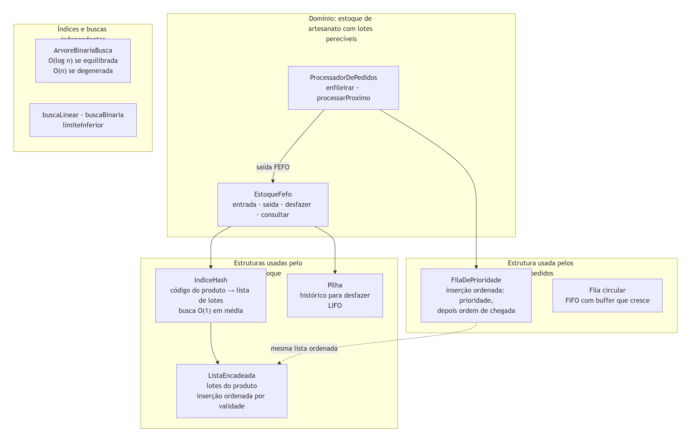
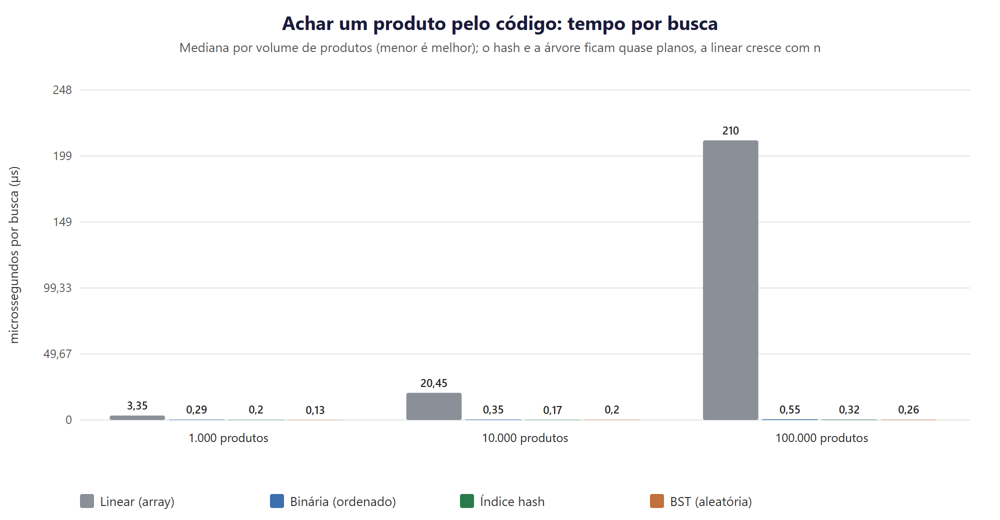
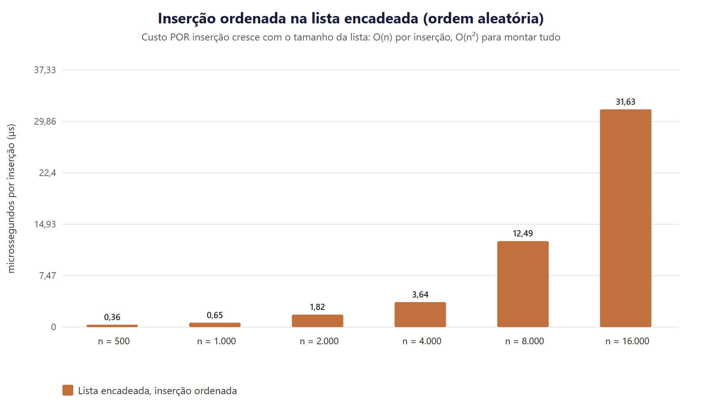
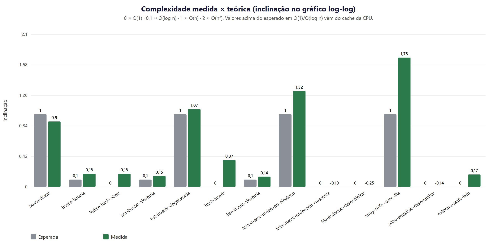

# Relatório de AED · Unidades 1 e 2 · Origem: Ponto da Terra

Algoritmos e Estruturas de Dados aplicados ao domínio do projeto: estoque de peças artesanais (com lotes que têm validade, como tintas, cera e peças com matéria-prima perecível) e fila de pedidos de saída de estoque.

> **O que é e o que não é.** Este é um módulo **independente**, em `backend/src/aed/`. Nenhuma rota da API o importa: o produto continua usando PostgreSQL (transação atômica no checkout, [ADR-002](../adr/adr-002-centralizar-a-reserva-de-estoque-no-servidor-com-transacao-atomica.md)). O módulo existe para modelar o problema com estruturas de dados escritas à mão, medir a complexidade e permitir ser plugado em qualquer parte do sistema. Nada aqui usa `Array.sort`, `Map` ou `Set` do JavaScript como estrutura principal (o `Map` aparece **só** nos testes, como referência para conferir o hash).

| Requisito do professor | Onde está |
|---|---|
| Modelagem do domínio com lista (estoque), fila (pedidos), pilha (histórico/desfazer) | [Seção 1](#1-modelagem-do-domínio) · `src/aed/estoque.ts`, `src/aed/pedidos.ts` |
| Saída de estoque por inserção ordenada (validade ou prioridade) | [Seção 2](#2-saída-por-inserção-ordenada) |
| Índice por hash (código do produto) | [Seção 3](#3-índice-por-hash) |
| Árvore binária de busca e busca binária | [Seção 4](#4-árvore-binária-de-busca-e-busca-binária) |
| Análise de complexidade + testes com dados sintéticos em volumes variados | [Seções 5 e 6](#5-complexidade-teórica) |
| Operações básicas testadas | [Seção 7](#7-testes) · 32 testes |
| Módulos expostos e código documentado | [Seção 8](#8-como-usar-e-integrar) |

## 1. Modelagem do domínio



*Fonte do diagrama: [`docs/aed/estruturas.mmd`](../aed/estruturas.mmd).*

| Conceito do domínio | Estrutura | Arquivo | Por que essa estrutura |
|---|---|---|---|
| **Estoque** de um produto: lotes que precisam sair em ordem de validade | **Lista encadeada** ordenada | `estruturas/lista-encadeada.ts` | Inserir no meio e retirar da cabeça sem deslocar elementos; a saída sempre consome o primeiro. |
| **Pedidos de saída**: atendidos por urgência | **Fila de prioridade** (lista ordenada) e **fila circular** (FIFO) | `estruturas/fila.ts` | A prioridade manda; entre iguais, vale a ordem de chegada (estável). A fila FIFO circular é usada onde só importa a ordem de chegada. |
| **Histórico** de entradas e saídas, para **desfazer** | **Pilha** | `estruturas/pilha.ts` | O último movimento é o primeiro a ser desfeito (LIFO). |
| **Achar o produto** pelo código | **Índice hash** (encadeamento) | `estruturas/indice-hash.ts` | Acesso em O(1) em média, sem varrer o catálogo. |
| Índice **ordenado** por chave | **Árvore binária de busca** | `estruturas/arvore-binaria-busca.ts` | Busca, inserção e remoção em O(log n) quando equilibrada; percurso em ordem sai ordenado. |
| Buscar em coleção **já ordenada** | **Busca binária** e **limite inferior** | `estruturas/busca.ts` | O(log n) contra O(n) da linear. |

`EstoqueFefo` (FEFO: *first expired, first out*) combina três delas: o **hash** leva do código do produto à **lista** de lotes (ordenada por validade), e cada operação empilha na **pilha** o "como desfazer".

Regras de negócio implementadas e testadas:

- a saída consome o lote de menor validade e passa ao seguinte quando ele acaba; lote sem validade vai para o fim;
- se o estoque total não basta, a saída é **recusada e não altera nada** (atomicidade da operação);
- `desfazer()` restaura **exatamente** o estado anterior (lotes esgotados voltam ao início, o lote parcial recupera a quantidade);
- pedidos: o mais urgente sai primeiro; com estoque escasso o de maior prioridade leva o estoque e o outro é recusado.

## 2. Saída por inserção ordenada

A lista de lotes **nunca é reordenada**: cada lote é inserido já no lugar certo (`inserirOrdenado`), percorrendo a lista até achar a posição. É a **inserção ordenada** do enunciado, e vale para dois critérios:

- **validade** (lotes de um produto, `compararPorValidade`);
- **prioridade do pedido** (`FilaDePrioridade`, comparador: prioridade e depois ordem de chegada).

A inserção é **estável** (valores iguais ficam na ordem em que chegaram) e tem um atalho: se o valor novo é maior ou igual ao último, entra no fim em O(1) sem percorrer a lista (caso comum, pois lotes novos costumam vencer mais tarde).

## 3. Índice por hash

`IndiceHash<V>`: tabela hash escrita do zero, com **encadeamento** para colisões, função **FNV-1a** de 32 bits sobre a string do código e **redimensionamento** (dobra os baldes quando o fator de carga passa de 0,75). Expõe `estatisticas()` (fator de carga, maior cadeia, colisões) para inspecionar a qualidade da distribuição. O teste confere o comportamento contra o `Map` do JavaScript em 20.000 operações aleatórias.

## 4. Árvore binária de busca e busca binária

A árvore é **iterativa** (sem recursão, então não estoura a pilha em árvores profundas) e **não balanceada**, de propósito: assim o relatório consegue mostrar o pior caso. Com chaves aleatórias a altura fica em torno de 2·log₂(n) (teste: altura < 40 para 2.000 chaves); com chaves **inseridas já em ordem**, a árvore vira uma lista e a altura é n (teste: altura = 2.000 para 2.000 chaves). A remoção trata os três casos (folha, um filho, dois filhos pelo sucessor em ordem).

`buscaBinaria` exige array ordenado e devolve o índice (ou −1). `limiteInferior` devolve a posição de inserção que mantém a ordem.

## 5. Complexidade teórica

| Operação | Estrutura | Melhor | Médio | Pior |
|---|---|---|---|---|
| Achar produto pelo código | Índice hash | O(1) | O(1) | O(n) (todas as chaves na mesma cadeia) |
| Achar produto pelo código | Busca linear em array | O(1) | O(n) | O(n) |
| Achar produto pelo código | Busca binária em array ordenado | O(1) | O(log n) | O(log n) |
| Buscar / inserir / remover | BST | O(log n) | O(log n) | **O(n)** (árvore degenerada) |
| Inserir lote ordenado por validade | Lista encadeada | O(1) (vence depois de todos) | O(k) | O(k), k = lotes do produto |
| Retirar o primeiro | Lista encadeada | O(1) | O(1) | O(1) |
| Enfileirar / desenfileirar | Fila circular | O(1) amortizado | O(1) amortizado | O(n) no redimensionamento |
| Enfileirar pedido por prioridade | Fila de prioridade (lista) | O(1) | O(n) | O(n) |
| Empilhar / desempilhar | Pilha | O(1) | O(1) | O(1) |
| Saída FEFO de um produto | Hash + lista | O(1) + O(lotes consumidos) | idem | idem |

Observação de projeto: a fila de prioridade por inserção ordenada custa O(n) por inserção. Um **heap binário** faria O(log n); a lista foi escolhida porque o enunciado pede a inserção ordenada e porque o número de pedidos pendentes por vez é pequeno. Está registrado como limitação na Seção 9.

## 6. Medição com dados sintéticos

Script: `cd backend && npm run benchmark:aed` (rápido: `-- --rapido`). Resultados: [`benchmark-aed-ultimo.json`](../aed/resultados/benchmark-aed-ultimo.json) e [`benchmark-aed-resumo.csv`](../aed/resultados/benchmark-aed-resumo.csv).

**Metodologia.** Dados determinísticos (gerador pseudoaleatório *mulberry32* com semente fixa: mesmos dados em toda execução); volumes de 1 mil a 1 milhão de itens (as operações O(n²) usam de 500 a 16 mil, por serem muito mais caras); 2 repetições de aquecimento descartadas e **9 repetições**, reportando a **mediana** (resistente a picos do coletor de lixo); o resultado de cada operação é consumido para o motor não eliminar o trabalho. A **inclinação** é a regressão linear de log(tempo por operação) contra log(n): ≈0 indica O(1), ≈0,1 O(log n), ≈1 O(n) e ≈2 O(n²).

Ambiente: Intel Core i7-1355U (12 núcleos), 16 GB, Windows 11, Node 24.22. Execução de 25/11/2026.







Tempo por operação (µs), mediana:

| Experimento | Teórica | Inclinação medida | Tempos por volume (n: µs) |
|---|---|---|---|
| Busca linear em array | O(n) | **0,90** | 1 mil: 3,35 · 10 mil: 20,5 · 100 mil: 210 |
| Busca binária (array ordenado) | O(log n) | 0,18 | 1 mil: 0,29 · 10 mil: 0,35 · 100 mil: 0,55 · 1 mi: 0,96 |
| Índice hash (obter) | O(1) | 0,18 | 1 mil: 0,20 · 10 mil: 0,17 · 100 mil: 0,32 · 1 mi: 0,62 |
| BST, chaves aleatórias (buscar) | O(log n) | 0,15 | 1 mil: 0,13 · 10 mil: 0,20 · 100 mil: 0,26 |
| BST, chaves em ordem (degenerada) | O(n) | **1,07** | 1 mil: 1,09 · 4 mil: 5,68 · 16 mil: 19,1 |
| Hash (inserir) | O(1) | 0,37 | 1 mil: 0,33 · 10 mil: 0,38 · 100 mil: 1,80 |
| BST aleatória (inserir) | O(log n) | 0,14 | 1 mil: 0,28 · 10 mil: 0,39 · 100 mil: 0,53 |
| Lista, inserção ordenada aleatória | O(n) | **1,32** | 500: 0,36 · 2 mil: 1,82 · 8 mil: 12,5 · 16 mil: 31,6 |
| Lista, inserção ordenada já crescente | O(1) | −0,19 | 1 mil: 0,077 · 100 mil: 0,009 · 1 mi: 0,029 |
| Fila circular | O(1) | −0,25 | 1 mil: 0,091 · 1 mi: 0,017 |
| Pilha | O(1) | −0,14 | 1 mil: 0,041 · 1 mi: 0,014 |
| Estoque FEFO (saída por código) | O(1) | 0,17 | 1 mil: 1,65 · 10 mil: 2,57 · 100 mil: 3,60 |

### Interpretação

- **A diferença que importa aparece.** Com 100 mil produtos, achar um código por varredura leva ~210 µs; pelo índice hash ~0,3 µs, cerca de **650 vezes** menos; pela busca binária ~0,55 µs. A busca linear cresce 63× quando o volume cresce 100× (inclinação 0,90), como o O(n) prevê.
- **Pior caso da BST confirmado.** Com as mesmas chaves, a árvore aleatória busca em ~0,2 µs e a degenerada (chaves inseridas em ordem) em 19 µs com apenas 16 mil nós, e a inclinação 1,07 mostra o comportamento linear. É o motivo de existirem árvores AVL e rubro-negras (não implementadas aqui; limitação na Seção 9).
- **Inserção ordenada é O(n) por inserção.** Montar a lista de 16 mil lotes em ordem aleatória custa 31,6 µs por inserção (inclinação 1,32, acima de 1 por efeitos de cache e do coletor de lixo na lista de nós espalhados), mas quando os lotes já chegam em ordem de validade o atalho da cauda torna a inserção O(1).
- **As operações O(1) e O(log n) não saem com inclinação exatamente 0 ou 0,1.** Medimos 0,15 a 0,37 nelas. A razão é o hardware, não o algoritmo: em volumes grandes os dados deixam de caber nos caches da CPU e cada acesso passa a custar mais (a hierarquia de memória). Inclinações levemente **negativas** (−0,14 a −0,25 na fila e na pilha) vêm do contrário: em volumes pequenos o custo fixo da medição e o aquecimento do compilador JIT pesam mais por operação. A ordem de grandeza e a separação entre as classes (≈0 contra ≈1) são claras; não se deve ler o segundo decimal como prova de complexidade.
- **Anomalia registrada: `Array.shift()` como fila.** Esperávamos O(n). O V8 otimiza o `shift` em arrays pequenos (até ~50 mil elementos o custo é baixo e constante, 0,07 a 0,09 µs); em 100 mil elementos o custo salta para ~309 µs por retirada, e a inclinação de 1,78 reflete esse **salto**, não uma reta. A conclusão correta é: a fila circular tem custo previsível em qualquer volume, enquanto o `shift` depende de uma otimização interna do motor que deixa de valer em volumes grandes.

## 7. Testes

`backend/tests/aed-estruturas.test.ts` e `backend/tests/aed-estoque.test.ts`: **32 testes, todos passando** (`cd backend && npx jest tests/aed-`).

- **Operações básicas e bordas** de cada estrutura (vazia, um elemento, remover cabeça/meio/cauda, crescimento do buffer da fila, capacidade inválida, chave repetida, colisão forçada em um único balde).
- **Testes aleatórios com semente fixa contra uma referência confiável**: lista ordenada contra array ordenado (5.000 operações), hash contra `Map` (20.000), BST contra mapa ordenado (10.000), busca binária contra linear em 50 arrays aleatórios.
- **Regras de negócio**: FEFO, recusa sem efeito colateral, validação de quantidades, `desfazer` restaurando o estado exato, pedidos por prioridade e desempate por chegada.

## 8. Como usar e integrar

```ts
import { EstoqueFefo, ProcessadorDePedidos } from './aed'; // backend/src/aed/index.ts

const estoque = new EstoqueFefo();
estoque.entrada({ id: 'L1', codigoProduto: 'PT-001', quantidade: 10, validade: new Date('2027-03-01') });
estoque.entrada({ id: 'L2', codigoProduto: 'PT-001', quantidade: 5, validade: new Date('2027-01-15') });

estoque.saida('PT-001', 8);   // consome L2 (vence antes) e depois L1
estoque.desfazer();           // volta ao estado anterior

const fila = new ProcessadorDePedidos();
fila.enfileirar({ id: 'P1', codigoProduto: 'PT-001', quantidade: 3, prioridade: 1 });
fila.processarTodos(estoque); // atende por prioridade; recusa o que falta estoque
```

Para integrar ao produto bastaria um adaptador que carregue os lotes do banco para um `EstoqueFefo` em memória (por exemplo, um relatório de "o que vence primeiro"); isso não foi feito porque o requisito é manter o produto como está. Todas as classes e métodos têm comentário de documentação (TSDoc) com a complexidade.

## 9. Limitações e decisões

- **A BST não se equilibra.** É de propósito (mostrar o pior caso), mas em uso real seria preciso AVL ou rubro-negra.
- **A fila de prioridade é uma lista ordenada (O(n) por inserção).** Um heap binário seria O(log n); fica como evolução.
- **O módulo é em memória.** Não persiste; o produto continua sendo a fonte de verdade no PostgreSQL.
- **A função hash FNV-1a não é criptográfica** (não deve receber entrada hostil sem tratamento; aqui os códigos são internos).
- **Os tempos valem para esta máquina.** Servem para comparar estruturas entre si e verificar a ordem de crescimento; não são garantia de desempenho em outro hardware.

## 10. Reprodução

```bash
cd backend
npx jest tests/aed-                  # 32 testes
npm run benchmark:aed                # benchmark completo (~3 min)
cd ../e2e && node gerar-graficos-aed-so.cjs        # gráficos
node renderizar-mermaid.cjs ../docs/aed/estruturas.mmd ../docs/aed/estruturas   # diagrama
```
