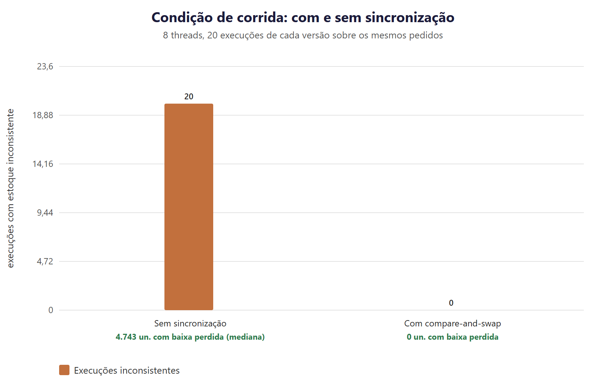
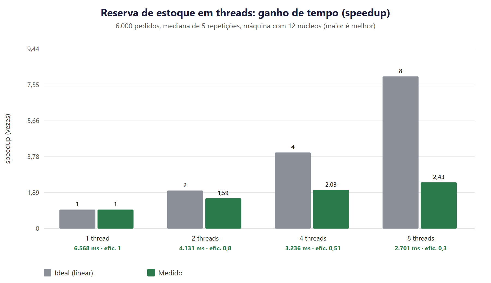

# Relatório de SO · Unidade 1 · Origem: Ponto da Terra

Sistemas Operacionais aplicados ao projeto: **threads e sincronização** no processamento de pedidos, **containerização**, **CI/CD**, **cenários de carga com orçamento** e **observabilidade**.

> Dentro do produto entra **apenas** o painel de monitoramento do administrador (descrito no [relatório da Unidade 2](RELATORIO_SO_U2.md#6-painel-de-monitoramento)). O restante é módulo independente, infraestrutura e documentação, como pedido.

| Requisito | Onde está |
|---|---|
| Threads no processamento concorrente de pedidos, com sincronização e condições de corrida | [Seção 1](#1-threads-sincronização-e-condição-de-corrida) · `backend/src/so/` |
| Containerização e CI/CD com deploy em nuvem | [Seções 2 e 3](#2-containerização) |
| 3 cenários (baixo, moderado, alto) com orçamento | [Seção 4](#4-cenários-de-carga-e-orçamento) |
| Monitoramento e observabilidade | [Seção 5](#5-observabilidade) |

## 1. Threads, sincronização e condição de corrida

### O que existia e o que foi acrescentado

O worker do projeto (`backend/src/worker.ts`) usa o **BullMQ**, que é um consumidor de fila rodando em **outro processo**; não é uma thread. O Node.js executa o JavaScript em uma única thread por processo, então o ganho de "paralelismo" que existia vinha de esperar várias operações de E/S ao mesmo tempo (ver [relatório de FCCPD](RELATORIO_FCCPD_U2.md)). Para demonstrar **threads de verdade**, o módulo `backend/src/so/` usa `worker_threads`: cada thread é uma thread do sistema operacional, roda em um núcleo próprio e **compartilha memória** com as demais por um `SharedArrayBuffer`.

Arquivos: `reserva-concorrente.ts` (orquestra: divide os pedidos, cria as threads, junta os resultados) e `reserva-worker.ts` (o código que cada thread executa). Independente do produto: nenhuma rota importa o módulo.

### O problema de negócio

Vários pedidos disputam as **últimas unidades** de uma peça de artesanato. Cada pedido faz duas coisas: (1) **trabalho de CPU**: assinar o pedido (HMAC-SHA256 repetido, como numa conferência de integridade) e (2) **reservar estoque**: ler o saldo, conferir se basta e baixar. O estoque de cada produto é um inteiro na memória compartilhada.

### Duas versões da reserva

| | Sem sincronização (didática) | Com sincronização |
|---|---|---|
| Passos | 1. lê o saldo · 2. confere · 3. assina o pedido · 4. grava `saldo − quantidade` | 1. assina o pedido · 2. lê o saldo · 3. `Atomics.compareExchange(saldo, lido, lido − quantidade)` · 4. se outra thread mexeu no meio, **repete** |
| Risco | Entre ler e gravar, outra thread muda o saldo: duas threads leem "10", ambas vendem 4 e ambas gravam "6" (**uma baixa se perde**); ou ambas vendem as últimas unidades (**venda acima do estoque**) | Nenhum: a troca só vale se o saldo ainda é o que a thread leu (*compare-and-swap*, instrução atômica do processador) |

A janela da corrida é o trabalho de CPU entre a leitura e a escrita. Quanto mais trabalho ali, mais fácil a corrida aparece, como na vida real (qualquer cálculo entre "conferi o estoque" e "baixei o estoque").

### Resultados (25/11/2026, i7-1355U, 12 núcleos)

Parâmetros: 6.000 pedidos sintéticos determinísticos, 8 produtos, estoque inicial cobrindo 60% da demanda (para haver disputa), 100 rodadas de HMAC por pedido.

**Corrida de dados** (8 threads, 20 execuções de cada versão sobre os mesmos pedidos):

| Versão | Execuções com estoque inconsistente | Unidades com baixa perdida (mediana) | Unidades vendidas acima do estoque (mediana) |
|---|---|---|---|
| Sem sincronização | **20 de 20** | 4.743 (máx. 5.470) | 4.668 (máx. 4.807) |
| Com compare-and-swap | **0 de 20** | 0 | 0 |



**Ganho de tempo por número de threads** (versão sincronizada, mediana de 5 repetições):

| Threads | Tempo | Speedup | Eficiência | Tentativas de CAS refeitas (mediana) |
|---|---|---|---|---|
| 1 | 6.568 ms | 1,00× | 1,00 | 0 |
| 2 | 4.131 ms | 1,59× | 0,80 | 0 |
| 4 | 3.236 ms | 2,03× | 0,51 | 1 |
| 8 | 2.701 ms | 2,43× | 0,30 | 2 |



Como ler: o ganho existe mas **não é linear**. Com 8 threads, 2,43× em vez de 8×. As causas, em ordem provável de peso: (a) o **tempo medido inclui criar as threads e carregar o `tsx` em cada uma** (custo fixo por thread, que pesa mais quando há mais threads e a tarefa total é curta, de poucos segundos); (b) a máquina é um notebook (i7-1355U: 2 núcleos de desempenho e 8 de eficiência, mais lentos, além de limites térmicos), então "12 núcleos" não são 12 núcleos iguais; (c) o custo da própria sincronização, que aqui é baixo (no máximo 2 tentativas refeitas na mediana). Não separamos esses três fatores experimentalmente; a lei de Amdahl e o custo de criação das threads são a explicação coerente, não uma medição individual de cada causa. Em ambiente compilado (`dist/`), onde não há carregador de TypeScript, o custo de partida seria menor.

### Quando usar threads no projeto

Threads compensam em trabalho **CPU-bound** (assinaturas, compressão de imagens, geração de PDF). Para o fluxo atual (consultas ao banco, E/S), o modelo assíncrono e a transação atômica do PostgreSQL ([ADR-002](../adr/adr-002-centralizar-a-reserva-de-estoque-no-servidor-com-transacao-atomica.md)) resolvem a mesma disputa pelo estoque com garantia de durabilidade, que a memória compartilhada não dá (ela some se o processo cai). Por isso o módulo é uma demonstração, não uma troca da reserva real.

### Testes

`backend/tests/so-threads.test.ts` (6 testes): pedidos determinísticos; **sincronizado com 4 threads é consistente em 5 execuções seguidas**; resultado igual ao de uma thread; sem sincronização com uma thread também é correto (a corrida só existe com paralelismo); sem sincronização com várias threads **perde atualizações** (o teste repete até 10 vezes até a corrida aparecer); número de threads inválido é recusado.

Reprodução: `cd backend && npx jest tests/so-threads` e `npm run benchmark:threads` (`-- --rapido` para fumaça). Dados: [`benchmark-threads-ultimo.json`](../so/resultados/benchmark-threads-ultimo.json).

## 2. Containerização

| Arquivo | Função |
|---|---|
| [`backend/Dockerfile`](../../backend/Dockerfile) | Imagem da **API e do worker** (a mesma imagem; o comando muda). Multi-stage, Node 22 Alpine, usuário sem privilégios, `HEALTHCHECK` em `/api/health`; aplica as migrations ao iniciar. |
| [`backend/docker-compose.completo.yml`](../../backend/docker-compose.completo.yml) | Pilha inteira: PostgreSQL 16, Redis 7, API, worker e site. Portas diferentes das do compose de desenvolvimento, para os dois coexistirem. |
| [`Dockerfile`](../../Dockerfile) (raiz) | Imagem do **site** Next.js (já existente no projeto). |
| `backend/docker-compose.yml` | Só PostgreSQL e Redis, para desenvolvimento (já existente). |

Comandos: `cd backend && docker compose -f docker-compose.completo.yml up --build -d`, depois `curl http://localhost:3333/api/health`.

**Verificação feita nesta entrega (25/11/2026, Docker 29.8.2):**

- `docker build` da API: sucesso. Tamanho da imagem: **967 MB**. É grande porque leva o `node_modules` completo (a CLI do Prisma, dependência de desenvolvimento, é necessária para `migrate deploy` ao iniciar). Reduzir (por exemplo, separar um job de migração) é uma melhoria registrada, não feita.
- Pilha subida: PostgreSQL, Redis e API **healthy**; as 7 migrations foram aplicadas pelo contêiner da API; o **worker** subiu e registrou `em execução (production) · filas: eventos, manutencao`; `/api/health` respondeu `{"api":"ok","banco":"ok","redis":"ok"}`.
- Seed no contêiner: o `prisma db seed` **recusa `NODE_ENV=production` de propósito** (ele apaga o banco). Para a demonstração local, roda-se com `-e NODE_ENV=development`, como documentado no compose.
- Benchmark de rede contra a API conteinerizada: [Relatório da Unidade 2](RELATORIO_SO_U2.md#7-benchmarking-de-rede).
- A imagem do **site** é construída pelo `Dockerfile` da raiz; o job de CI abaixo a constrói em toda execução.

## 3. CI/CD

### Integração contínua (já existia, ampliada)

`.github/workflows/ci.yml` roda em todo push na `main`/`integracao-backend` e em todo pull request:

| Job | O que faz |
|---|---|
| Backend | PostgreSQL e Redis como serviços, `npm ci`, lint sem `any`, checagem de tipos, **testes (Jest + Supertest)**, build |
| Frontend | lint, tipos, `next build` |
| **Imagens Docker** (novo) | depois dos dois anteriores: constrói a imagem da API e do site, **sobe a pilha com `docker compose` e confere `/api/health`**, derruba |

### Entrega contínua (novo)

`.github/workflows/deploy.yml` publica na **Vercel** quando o CI termina com sucesso na `main` (ou manualmente, por `workflow_dispatch`): `vercel pull` → `vercel build --prod` → `vercel deploy --prebuilt --prod`, primeiro a **API** (o build aplica as migrations no banco de produção), depois confere `/api/health` e só então publica o **site**.

**Estado real, sem rodeio:**

- O deploy atual do projeto continua sendo feito **manualmente por linha de comando** ([DEPLOY_VERCEL.md](DEPLOY_VERCEL.md)); a conexão automática Vercel↔GitHub não está ligada.
- O workflow de deploy **só executa se os 4 segredos existirem** no repositório (`VERCEL_TOKEN`, `VERCEL_ORG_ID`, `VERCEL_PROJECT_ID_API`, `VERCEL_PROJECT_ID_SITE`; onde achar cada um está no cabeçalho do arquivo). Sem eles o job termina com um aviso e **pula o deploy**, sem quebrar o CI. Os segredos são do dono da conta na Vercel; eles não estão no repositório e não foram criados por esta entrega.
- Os dois workflows tiveram a sintaxe validada localmente (YAML válido, jobs e dependências conferidos). **Não foram executados no GitHub Actions** por esta entrega: a primeira execução real acontecerá no pull request; o deploy só ao configurar os segredos e fazer merge na `main`.
- Por segurança, o `vercel.json` já bloqueia deploy automático de outras branches (previews usam o mesmo banco de produção).

## 4. Cenários de carga e orçamento

### Premissas (hipóteses de trabalho, **não** medições)

O projeto não tem dados reais de uso. Os três cenários abaixo são **hipóteses** de plataforma em fase de lançamento, crescimento e campanha. Cada comprador ativo gera ~4 sessões por mês de ~25 chamadas à API (100 requisições/mês); cada pedido gera ~6 eventos na fila (pedido criado, pago, notificações, e-mail).

| | **Baixo** (lançamento) | **Moderado** (crescimento) | **Alto** (campanha de fim de ano) |
|---|---|---|---|
| Compradores ativos/mês | 200 | 5.000 | 100.000 |
| Pedidos/mês | 300 | 5.000 | 100.000 |
| Requisições/mês | ~20 mil | ~500 mil | ~10 milhões |
| Pico de requisições/s | 2 | 25 | 300 |
| Eventos na fila/mês | ~2 mil | ~30 mil | ~600 mil |
| Fotos armazenadas | ~1 GB (100 peças) | ~20 GB | ~100 GB |

### O que a medição diz sobre capacidade

Medições feitas nesta entrega ([Unidade 2](RELATORIO_SO_U2.md#7-benchmarking-de-rede)) servem de âncora, com ressalvas:

- A API em **contêiner no notebook** (banco local, vitrine com dados do seed) sustentou **~175 req/s com 5 conexões e ~193 req/s com 20**, p95 de 50 a 165 ms e 0% de perda; a mesma API rodando direto no Node (sem contêiner, banco de desenvolvimento) chegou a 400 e 568 req/s. Isso é **menos que o pico de 300 req/s do cenário alto** para um único contêiner pequeno, e sem rede entre API e banco; por isso o cenário alto prevê 2 ou mais instâncias.
- A API em **produção (Vercel Hobby)**, medida com no máximo 10 conexões simultâneas (para não sobrecarregar o ambiente de demonstração), chegou a ~24 req/s na vitrine, limitada pela latência por requisição (p50 de 434 ms), não por saturação; não medimos o limite real de produção.
- O cabeçalho `x-vercel-id: gru1::iad1::...` das respostas de produção mostra que a requisição **entra no ponto de presença de São Paulo (`gru1`) mas a função roda em `iad1` (Virgínia, EUA)**. Esse deslocamento explica por que até o endpoint mais leve (`/frete`, 1,2 ms de processamento local) leva ~197 ms em produção: é viagem de rede, não CPU. Isso é uma inferência a partir do cabeçalho e dos tempos. Uma decomposição por conexão nova ([Unidade 2, Seção 2.1](RELATORIO_SO_U2.md#21-topologia-de-rede-enlaces-meios-e-medidas)) a **reforça**: o TCP até São Paulo leva ~19 ms e a espera pelo servidor, ~207 a 212 ms, igual com e sem banco. A região do banco Neon **não foi verificada** (a confirmar no painel do Neon).

### Orçamento por cenário

Preços oficiais consultados em **25/11/2026** (fontes na tabela seguinte). Câmbio: **PTAX venda de 25/11/2026 = R$ 5,8825 por US$** (Banco Central). Valores em US$ sem impostos e **sem tráfego excedente**; o orçamento é uma estimativa a partir das premissas, não uma cotação.

| Item | Baixo (acadêmico) | Baixo (comercial) | Moderado | Alto |
|---|---|---|---|---|
| Hospedagem do site | Vercel Hobby: 0 | Vercel Pro: **20** | Vercel Pro: **20** | Vercel Pro: **20** |
| API | Vercel Hobby: 0 | Vercel Pro (inclusa) | Vercel Pro: funções ~0,30 (500 mil × US$ 0,60/mi) | **AWS ECS Fargate**, sa-east-1, 2 tarefas de 1 vCPU + 2 GB, 24×7: 2 × 61,9 = **123,8** |
| PostgreSQL | Neon Free: 0 | Neon Free: 0 | Neon Launch: 0,25 CU × 730 h × 0,106 = **19,35** + 5 GB × 0,35 = **1,75** | **RDS PostgreSQL** db.t4g.medium Multi-AZ, sa-east-1: 0,275 × 730 = **200,75** (+ armazenamento: não confirmado) |
| Redis | Upstash Free: 0 | Free: 0 | Pay-as-you-go: 1,5 mi comandos × 0,20/100 mil = **3,00** | Upstash Fixed 1 GB: **20** |
| Fila (QStash) | Free: 0 | Free: 0 | Pay-as-you-go: 30 mil × 1/100 mil = **0,30** | Pay-as-you-go: 600 mil × 1/100 mil = **6,00** |
| Fotos (Blob) | Hobby: 0 | Hobby: 0 | 20 GB × 0,023 = **0,46** | 100 GB × 0,023 = **2,30** |
| **Total estimado (US$/mês)** | **0** | **20** | **≈ 45,2** | **≈ 372,9** |
| **Total estimado (R$/mês)** | **0** | **≈ 117,65** | **≈ 265,65** | **≈ 2.193,30** |
| **Não incluído / não confirmado** | | | Crédito mensal do Vercel Pro (não confirmado); transferência excedente | Armazenamento do RDS, balanceador de carga, transferência de dados, logs e backups (**não confirmados**); preços da Vercel Blob para a região de São Paulo |

Fontes: Vercel (vercel.com/pricing, vercel.com/docs/plans/hobby, vercel.com/legal/terms); Neon (neon.com/pricing); Upstash (upstash.com/pricing/redis e /qstash); Vercel Blob (vercel.com/docs/vercel-blob/usage-and-pricing); AWS ECS e RDS (arquivos oficiais de preço `pricing.us-east-1.amazonaws.com`, região `sa-east-1`, publicados em 24 e 25/11/2026); câmbio (Banco Central, PTAX, API Olinda).

**Pontos de atenção de negócio:**

1. O plano **Hobby da Vercel não permite uso comercial** (Termos de Serviço, Seção 4). Para o projeto acadêmico o custo é zero; para vender de verdade, o piso é o Pro, US$ 20 por mês.
2. No cenário alto o item que mais pesa é o **banco** (US$ 200,75 só de instância Multi-AZ), não a aplicação.
3. A conta do cenário alto **não está completa** (itens não confirmados acima); trate US$ 373 como piso, não como teto.

### Como a arquitetura muda entre os cenários

| | Baixo | Moderado | Alto |
|---|---|---|---|
| API | Função serverless (Vercel) | Função serverless, **região `gru1`** | **Contêiner** (Fargate) atrás de balanceador, 2+ instâncias |
| Banco | Neon Free | Neon Launch, região **São Paulo** (`aws-sa-east-1`, suportada) | RDS **Multi-AZ** em São Paulo, pool de conexões |
| Fila | QStash | QStash | QStash ou worker BullMQ no mesmo cluster |
| Observabilidade | Painel do admin | Painel do admin + logs da plataforma | Painel + métricas e alarmes da nuvem (CloudWatch) |
| Gatilho para subir de cenário | — | Latência p95 acima de 500 ms ou uso comercial | Pico acima de ~100 req/s sustentado ou banco acima de 70% de uso |

O plano de migração entre esses estados está em [RELATORIO_SO_U2.md](RELATORIO_SO_U2.md#9-plano-de-implantação-e-migração).

## 5. Observabilidade

Antes desta entrega a observabilidade era só `/api/health` e o log `morgan`. Agora a API **mede a si mesma** (latência, vazão, jitter, falhas, atraso do laço de eventos, RTT ao banco e ao Redis, fila de eventos) e expõe tudo em `GET /api/admin/monitoramento`, somente para administradores, com a página `/admin/monitoramento`. Detalhes, limites e evidências na [Seção 6 do relatório da Unidade 2](RELATORIO_SO_U2.md#6-painel-de-monitoramento).

## 6. Reprodução

```bash
cd backend
npx jest tests/so-threads                 # threads: 6 testes
npm run benchmark:threads                 # speedup e corrida de dados (~3 min)
docker compose -f docker-compose.completo.yml up --build -d    # pilha completa
curl http://localhost:3333/api/health
docker compose -f docker-compose.completo.yml down -v
cd ../e2e && node gerar-graficos-aed-so.cjs
```

## 7. Limitações

- Os cenários e o orçamento partem de **hipóteses de uso**, não de dados reais.
- O módulo de threads demonstra o conceito sobre memória compartilhada em um processo; não substitui a reserva transacional do banco.
- O deploy automático depende de segredos que o dono da conta Vercel precisa cadastrar; os workflows não rodaram no GitHub ainda.
- A imagem da API tem 967 MB.
