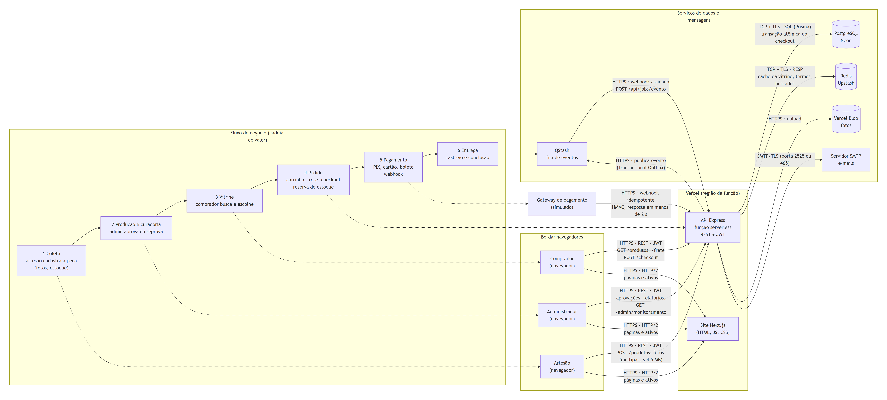
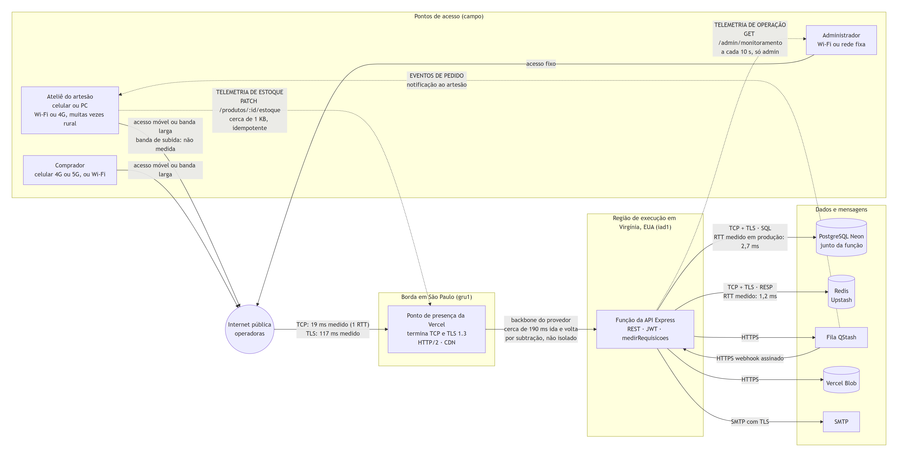
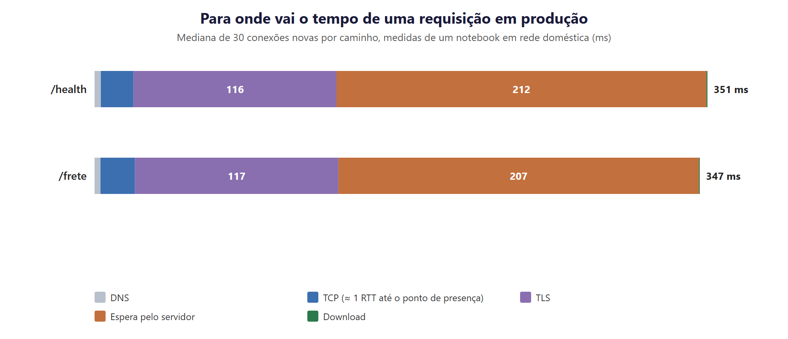
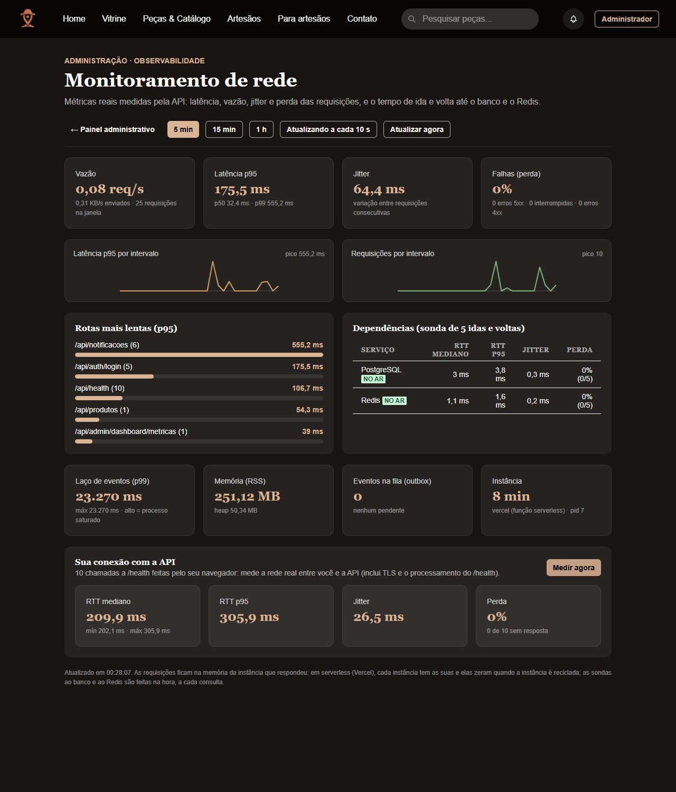
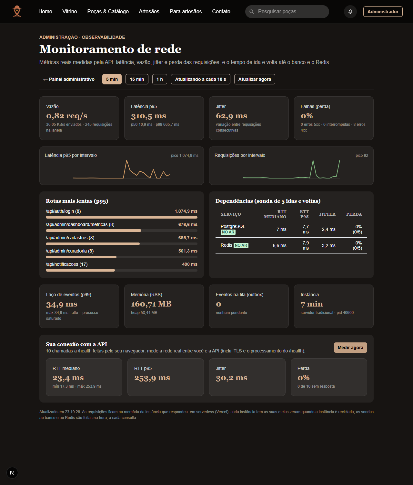
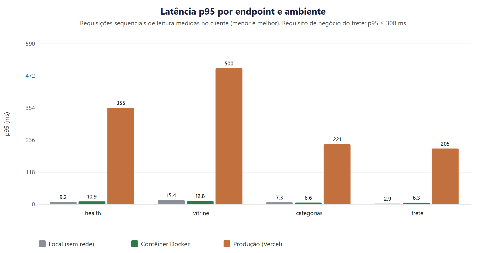
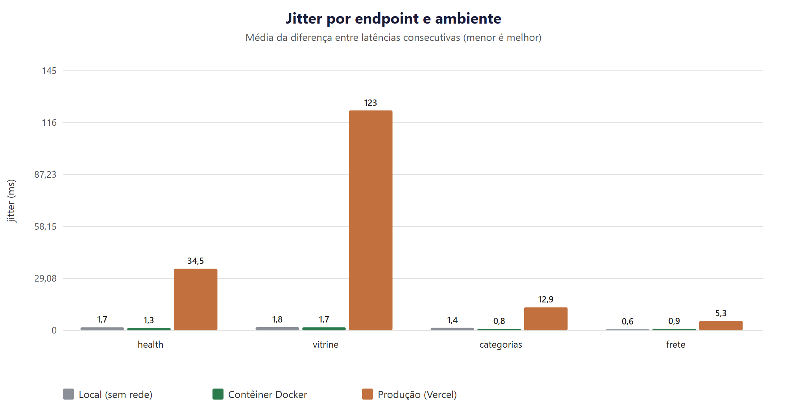
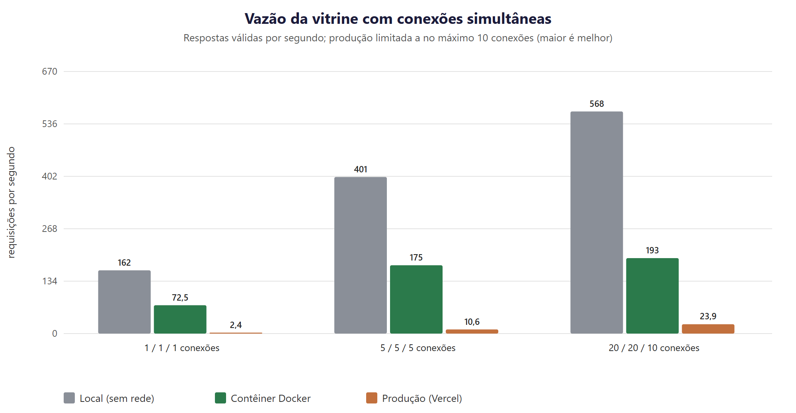

# Relatório de SO · Unidade 2 · Origem: Ponto da Terra

Redes aplicadas ao projeto: **topologia** pelo fluxo do negócio, **requisitos de rede** derivados dos requisitos funcionais, **protocolos e APIs** justificados, **benchmarking** de latência, vazão, perda e jitter (local, em contêiner e em produção), **painel de monitoramento** para o administrador e **plano de implantação e migração**.

> Este é o relatório da **Unidade 2**. Threads, contêineres, CI/CD, cenários e orçamento estão no [relatório da Unidade 1](RELATORIO_SO_U1.md). Dentro do produto entra **apenas** o painel de monitoramento do administrador (Seção 6).

| Requisito | Onde está |
|---|---|
| Topologia de rede (20%) | [Seção 2](#2-topologia) |
| Requisitos de rede derivados do negócio (17%) | [Seção 3](#3-requisitos-de-rede-derivados-do-negócio) |
| Protocolos e APIs definidos e justificados (13%) | [Seção 4](#4-protocolos-e-apis) |
| Benchmarking: latência, vazão, perda, jitter, interpretados (20%) | [Seções 5, 7 e 8](#5-o-que-cada-métrica-significa) |
| Painel web de monitoramento com métricas reais de rede (17%) | [Seção 6](#6-painel-de-monitoramento) |
| Plano de implantação e migração coerente com os cenários (13%) | [Seção 9](#9-plano-de-implantação-e-migração) |

## 1. Contexto do sistema

Marketplace de artesanato: site Next.js (Vercel) e API REST Express 5 (função serverless na Vercel), com PostgreSQL (Neon), Redis (Upstash), fila (QStash), fotos (Vercel Blob) e e-mail por SMTP. Os usuários são compradores, artesãos (muitas vezes em regiões com conexão limitada) e o administrador.

### 1.1 Onde cada número foi medido

Os números deste relatório vêm de ambientes diferentes. Para não misturar, cada medição está identificada:

| Medição | Ambiente | Data | Onde está |
|---|---|---|---|
| Benchmark de rede **local** | Notebook, API direto no Node, banco de desenvolvimento | 25/11/2026 | Seção 7, `benchmark-rede-local.json` |
| Benchmark de rede em **contêiner** | Notebook, Docker (API, banco e Redis em contêineres) | 25/11/2026 | Seção 7, `benchmark-rede-conteiner.json` |
| Benchmark de rede em **produção** | Notebook em rede doméstica → API na Vercel, pela internet | 25/11/2026 | Seção 7, `benchmark-rede-producao.json` |
| Decomposição dos enlaces (DNS, TCP, TLS, espera) | Notebook → API na Vercel | 25/11/2026 | Seção 2.1, `benchmark-enlaces-producao.json` |
| **RTT do banco e do Redis, tempo da consulta ao painel** | **Dentro da função na Vercel (produção)**, medido pelo próprio painel | **26/11/2026** | Seção 6, `monitoramento-producao.json` |
| Captura do painel e verificação de acessos | **Produção** (e, antes do deploy, desenvolvimento local) | 26/11/2026 (produção) | Seção 6, `docs/so/evidencias/` |
| Threads e estruturas de dados (AED) | Notebook | 25/11/2026 | Relatórios de AED e da Unidade 1 |

## 2. Topologia

A topologia segue o **fluxo do negócio** (coleta → curadoria → vitrine → pedido → pagamento → entrega): cada etapa é ligada ao componente de rede que a atende e cada ligação mostra o **protocolo e o motivo de existir**.



*Fonte: [`docs/so/topologia.mmd`](../so/topologia.mmd). Versão vetorial: [`topologia.svg`](../so/topologia.svg).*

| Etapa do negócio | Quem fala com quem | Característica de rede |
|---|---|---|
| 1. Coleta (artesão cadastra a peça) | navegador do artesão → API → Blob e PostgreSQL | Upload de fotos (até 4,5 MB na Vercel): **sensível à banda de subida** do artesão |
| 2. Curadoria | navegador do admin → API → PostgreSQL; e-mail de aviso por SMTP | Poucas requisições, payload pequeno; o aviso ao artesão é **assíncrono** |
| 3. Vitrine | navegador do comprador → site e API (cache no Redis) | **Maior volume de tráfego**; resposta de ~90 KB por página de 12 peças; sensível à latência |
| 4. Pedido (carrinho, frete, checkout) | navegador → API → PostgreSQL (transação atômica) | Frete exige resposta rápida; checkout é a operação de maior contenção |
| 5. Pagamento | gateway (simulado) → API por webhook | **Entrada** de rede: resposta rápida e idempotente; assinatura HMAC |
| 6. Entrega e notificações | API → QStash → API (webhook) → SMTP | Tolerante a atraso, **não pode perder** mensagem (Transactional Outbox) |

### 2.1 Topologia de rede: enlaces, meios e medidas

O diagrama acima mostra **componentes de software**. Este mostra a **rede por onde os dados viajam**: os pontos de acesso (campo), a internet, a borda em São Paulo, a região onde a função executa e os serviços de dados, com o tipo de enlace e o que **foi medido** em cada trecho. Linhas tracejadas são os fluxos de **telemetria** (Seção 2.2).



*Fonte: [`docs/so/topologia-rede.mmd`](../so/topologia-rede.mmd). Versão vetorial: [`topologia-rede.svg`](../so/topologia-rede.svg).*

Para separar o que é rede de acesso do que é caminho interno do provedor, `npm run benchmark:enlaces` decompõe cada requisição em **conexão nova** (DNS, TCP, TLS, espera pelo servidor, download). Resultado (mediana de 30 conexões por caminho, 25/11/2026, notebook em rede doméstica, somente leitura):



| # | Enlace | Meio e tecnologia | O que foi medido | O que não foi medido |
|---|---|---|---|---|
| 1 | Artesão, comprador e admin → internet | Acesso móvel (4G ou 5G) ou banda larga e Wi-Fi; no ateliê, muitas vezes rural | DNS: 3,4 a 3,6 ms | Banda e latência do acesso de cada usuário (cada um tem o seu). A banda de subida de 1 Mbps usada em RR4 é **premissa**. |
| 2 | Internet → ponto de presença em São Paulo (`gru1`) | Internet pública das operadoras | **Conexão TCP: 18,7 a 19,7 ms** (≈ 1 RTT até o ponto de presença) | Perda de pacotes no trecho |
| 3 | Handshake TLS 1.3 com o ponto de presença | Criptografia do canal | **116 a 117 ms** | Causa. TLS 1.3 gasta 1 RTT (≈ 19 ms aqui), então 117 ms é mais do que o esperado; **não sei explicar** (pode ser o cliente Node no Windows ou a borda). Em HTTP/2 com a conexão reaproveitada, paga-se uma vez por sessão. |
| 4 | Ponto de presença `gru1` → função em `iad1` → de volta | Backbone do provedor | **Espera pelo servidor: 207 a 212 ms**. Descontado 1 RTT de acesso (≈ 19 ms), sobram **~190 ms** de caminho interno | O trecho isolado. É um resultado por subtração. |
| 5 | Função ↔ PostgreSQL e Redis | TCP com TLS (SQL, RESP) | **Medido pelo painel em produção** (15 leituras em 26/11/2026, 5 sondas cada, de dentro da função): **PostgreSQL 2,7 ms** de RTT mediano (as medianas por leitura vão de 2,4 a 2,9 ms), jitter mediano 0,34 ms; **Redis 1,2 ms**, jitter mediano 0,23 ms; perda 0% | QStash, Blob e SMTP (sem sonda). A região exata do Neon, que não consultei no painel do provedor. |

**Leitura.** (a) O **acesso do usuário não é o problema**: 19 ms até o ponto de presença. (b) O tempo de espera é praticamente **igual em `/health` e `/frete`** (212 contra 207 ms), embora `/health` consulte o banco e o Redis e `/frete` não; logo, o banco, **por si só**, não explica esse tempo. (c) O dado é **compatível** com a função em outra região (o cabeçalho `X-Vercel-Id: gru1::iad1::…` indica Virgínia), o que **não foi isolado**; mas o **banco e o Redis estão a 1 a 3 ms da função** (linha 5), ou seja, **colados a ela**. Logo, a função **e** os dados estão longe de São Paulo, e os ~190 ms são o trecho entre o ponto de presença e a função, não o caminho até o banco. (d) Uma conexão nova custa ~350 ms no total; por isso o reaproveitamento de conexões (HTTP/2 e `keep-alive`) importa: a vitrine medida na Seção 7 já usa conexões reaproveitadas e leva 434 ms de mediana.

### 2.2 Fluxo de telemetria

Telemetria aqui é o dado que sai dos **pontos de campo** (ateliês) e da **própria operação** rumo ao sistema, em um enlace que pode ser instável. Está separado entre o que **já existe** e o que é **proposta**:

| Fluxo | Origem → destino | Situação | Protocolo e tamanho | Observação |
|---|---|---|---|---|
| Ajuste de estoque pelo artesão | Ateliê → API (`PATCH /api/produtos/:id/estoque`, só artesão) | **Existe** | HTTPS, JSON `{ quantidade }`; ~1 KB com cabeçalhos e JWT (**estimativa**, não medida) | A rota **define** a quantidade (valor absoluto), então refazer a chamada tem o mesmo efeito: é **idempotente** |
| Eventos de pedido, pagamento e expiração | API → fila (QStash) → API (webhook) → notificação ao artesão e e-mail | **Existe** | HTTPS; gravados na Outbox na mesma transação do pedido | Entrega *at-least-once* com consumo idempotente |
| Métricas de operação | API → painel do administrador (`GET /api/admin/monitoramento`) | **Existe** (novo nesta entrega) | HTTPS; consulta a cada 10 s enquanto a página está aberta | Telemetria da própria rede e do processo (Seção 6) |
| Reenvio com espera crescente (*backoff*) e envio em lote de ajustes | Ateliê → API | **Proposta, não implementada** | — | Para enlaces móveis instáveis; faz sentido porque o ajuste é idempotente |

**Localização do fluxo de campo na topologia:** o ateliê entra pelo enlace de acesso, atravessa a internet e o ponto de presença de São Paulo e chega à função; a confirmação volta pelo mesmo caminho. Cada tentativa custa, no mínimo, o RTT de acesso mais o caminho interno de ~190 ms (Seção 2.1), então o cliente do artesão deve tolerar respostas de ~0,3 a 0,5 s por tentativa sem tratá-las como falha.

## 3. Requisitos de rede derivados do negócio

Cada requisito de rede abaixo vem de um requisito funcional ou regra de negócio já documentado (coluna "Origem"), com a **conta** que leva de um ao outro. Onde a origem é uma **meta proposta pela equipe** (não consta nos requisitos), está dito.

| # | Requisito de rede | Origem | Conta ou justificativa | Medido em produção | Atende? |
|---|---|---|---|---|---|
| RR1 | **Frete: latência p95 ≤ 300 ms**, medida no cliente | RN16 (REQUISITOS_BACKEND): "frete simulado por CEP, com resposta em < 300 ms" | Direto da regra | p95 **205 ms** (p50 197 ms) | Sim, com folga de 95 ms |
| RR2 | **Webhook de pagamento processado em < 2 s**, idempotente | RN19 / TC16: "o webhook muda para PAGO em < 2 s" | Orçamento **proposto**: chegada do gateway ≤ 0,3 s + autenticação e transação no banco ≤ 0,7 s + folga 1 s = 2 s | Não medido (gateway simulado, sem endpoint de leitura para medir sem alterar dados); o teste automatizado TC16 cobre a correção | **Não medido** |
| RR3 | **Vitrine: página de 12 peças ≤ 100 KB** e p95 ≤ 800 ms | Meta **proposta pela equipe** (não consta nos requisitos). Conta: 90 KB = 720 kbit; em um celular com 1,6 Mbps o download leva 0,45 s, deixando ~0,35 s para rede e servidor dentro de 0,8 s | Equivale ao "tempo de uma tela" aceitável para mobile | **90,6 KB** (decodificado; a resposta trafega em Brotli) e p95 **500 ms** | Sim |
| RR4 | **Upload de foto ≤ 4,5 MB concluir em tempo razoável** | RN de upload (até 5 MB localmente) e limite de corpo da Vercel (4,5 MB) | Em um enlace de subida de 1 Mbps, 4,5 MB = 36 Mbit levam **36 s**; é preciso feedback de progresso e/ou compressão no cliente | Não medido (altera dados) | Risco registrado |
| RR5 | **Checkout aguenta 50 compradores simultâneos sem vender acima do estoque** | TC02 / k6 de 50 VUs | Concorrência é por transação do banco, não pela rede; a rede só precisa sustentar 50 conexões | Teste k6 existente (`backend/tests/carga/`) | Coberto em outro relatório |
| RR6 | **Vazão sustentada** por cenário: 2 / 25 / 300 req/s | Cenários da [Unidade 1](RELATORIO_SO_U1.md#4-cenários-de-carga-e-orçamento) (hipóteses) | Pico estimado por cenário | Contêiner local: 175 a 193 req/s; produção: ≥ 24 req/s medido com no máximo 10 conexões | Cenário alto exige mais de uma instância |
| RR7 | **Perda de requisições ≤ 1%** (o cliente refaz; o servidor é idempotente onde importa) | Meta **proposta pela equipe**; eventos (pedido, notificação) **não podem se perder**, o que a Outbox garante independentemente da rede | Disponibilidade-alvo de 99,5% = até 3,65 h de indisponibilidade por mês (0,5% de 730 h) | 0% nas 3 baterias | Sim (amostra pequena, ver limites) |
| RR8 | **Jitter da vitrine ≤ 100 ms** | Meta **proposta pela equipe**: variação alta de latência causa "engasgos" na rolagem e na busca | Ordem de grandeza do tempo de uma interação percebida como instantânea | **123 ms** na vitrine (5 ms no frete) | **Não atende** na vitrine |
| RR9 | **Canal seguro** (TLS) em todo o tráfego e HSTS | Segurança: JWT e senhas trafegam na rede | Sem TLS o token vaza em redes abertas | TLS 1.3 + HTTP/2 negociados; `Strict-Transport-Security: max-age=31536000; includeSubDomains` | Sim |
| RR10 | **Ajuste de estoque reenviável sem efeito colateral** (telemetria de campo em enlace instável) | Enlace de acesso do ateliê (premissa, Seção 2.1) e a rota `PATCH /produtos/:id/estoque` | A rota define a quantidade absoluta; repetir N vezes dá o mesmo resultado. O cliente pode reenviar com *backoff* (1, 2, 4, 8 s…) até receber 200, sem chave de idempotência | Por desenho da rota; o reenvio automático no cliente é proposta | Parcial (servidor pronto, cliente não) |
| RR11 | **Defasagem do estoque na vitrine ≤ 60 s**, com exatidão garantida no momento da compra | TTL do cache da vitrine (60 s, [ADR-001](../adr/adr-001-adotar-cache-no-redis-com-fallback-para-o-postgresql-na-camada-de-servicos-da-vitrine.md)) e reserva atômica no servidor ([ADR-002](../adr/adr-002-centralizar-a-reserva-de-estoque-no-servidor-com-transacao-atomica.md), TC14) | A vitrine pode mostrar a quantidade com até 60 s de atraso; o carrinho e o checkout conferem o saldo real no banco, então o atraso nunca causa venda acima do estoque | Por desenho; testado pelo TC14 e pelo teste de concorrência do checkout | Sim |
| RR12 | **Banda de telemetria de estoque e eventos desprezível** | Cenários da [Unidade 1](RELATORIO_SO_U1.md#4-cenários-de-carga-e-orçamento) | ~1 KB por evento (estimativa). No cenário alto, 600 mil eventos por mês = 600.000 ÷ (30 × 86.400 s) = **0,23 evento/s ≈ 0,23 KB/s**. Não exige enlace dedicado | Não medido; conta a partir de premissas | Sim (conta) |
| RR13 | **O painel de monitoramento não pode pesar na API** | O painel consulta a cada 10 s | Cada consulta faz 5 idas e voltas ao banco, 5 ao Redis e 2 consultas de fila: ~12 operações. A 0,1 consulta/s, é pequena frente a 25 req/s (moderado) ou 300 req/s (alto), mas pode chegar a ~5% das requisições no cenário baixo (2 req/s), **só enquanto a página estiver aberta** | **Em produção, a consulta leva 230 ms de mediana (p95 384 ms)** em 15 leituras, contra ~197 ms de um `/frete`: a diferença, ~33 ms, é da ordem do custo das ~12 operações mais a autenticação | Aceitável |

## 4. Protocolos e APIs

| Ligação | Protocolo | Por que este e não outro |
|---|---|---|
| Navegador ↔ API | **HTTPS** (TLS 1.3, HTTP/2 negociado via ALPN), estilo **REST** com JSON | Os recursos (produtos, pedidos, carrinho) são naturais em REST; funciona em qualquer cliente; cache e ferramentas de depuração padrão. **gRPC** não roda direto no navegador sem proxy; **GraphQL** resolveria o excesso de dados da vitrine, mas aumentaria a complexidade para esta API. HTTP/2 multiplexa as requisições da vitrine em uma conexão. |
| Autenticação | **JWT** no cabeçalho `Authorization: Bearer` (expira em 2 h, revogável por `tokenVersion`) | Sem estado de sessão no servidor (serverless não mantém memória); a revogação imediata está no [ADR-003](../adr/adr-003-adotar-revogacao-imediata-de-acesso-com-jwt-e-tokenversion-conferido-a-cada-requisicao.md). Alternativa, cookie de sessão: exigiria armazenamento compartilhado de sessão e proteção contra CSRF. |
| Navegador ↔ Site | HTTPS / HTTP/2, HTML, JS e CSS estáticos | Servido pela CDN da Vercel, perto do usuário (`gru1`) |
| API ↔ PostgreSQL | **Protocolo PostgreSQL sobre TCP + TLS** (Prisma com adaptador `pg`, *pooling*) | O banco é relacional e o checkout depende de **transação ACID**; o pool evita abrir uma conexão por requisição em serverless |
| API ↔ Redis | **RESP sobre TCP + TLS** (Upstash) | Cache da vitrine (TTL de 60 s) e termos mais buscados; latência de submilissegundo no mesmo datacenter; o sistema **degrada** para o banco se o Redis cair ([ADR-001](../adr/adr-001-adotar-cache-no-redis-com-fallback-para-o-postgresql-na-camada-de-servicos-da-vitrine.md)) |
| API → fila → API | **HTTPS**: a API publica no **QStash**, que devolve a mensagem por **webhook assinado** (`POST /api/jobs/evento`, assinatura verificada com chave rotativa) | Função serverless não mantém um consumidor ligado; entrega com repetição automática; casa com a **Transactional Outbox** (o evento é gravado na mesma transação do pedido e depois publicado). Alternativa, **AMQP/RabbitMQ**: exigiria um servidor sempre ligado. Localmente usa-se BullMQ sobre Redis. |
| Gateway de pagamento → API | **HTTPS webhook** com **HMAC** (`WEBHOOK_SECRET`) e **idempotência** | O gateway chama a API; a assinatura impede falsificação e a idempotência impede cobrar duas vezes quando o gateway repete a chamada (TC16) |
| API → fotos | **HTTPS** para o Vercel Blob (`multipart/form-data` no envio) | Armazenamento de objetos fora da função (que não tem disco persistente) |
| API → e-mail | **SMTP com TLS** (portas 2525 ou 465) | Padrão universal dos provedores de e-mail; hoje Mailtrap (caixa de testes) |
| Descrição da API | **OpenAPI 3** em `/api/openapi.json`, **Swagger UI** em `/api/docs` | Contrato legível por máquina, usado também pelos testes de contrato |
| Formato de resposta | Envelope `{ success, data, error, errors?, meta? }`, paginação por `page` e `limit` | Cliente trata sucesso e erro de um único jeito |
| Segurança de borda | `helmet` (cabeçalhos), CORS por lista de origens, limite de tentativas de login, corpo de até 1 MB | Reduz a superfície de ataque; 20 de 20 ataques do roteiro de segurança foram bloqueados |

**Verificado em produção em 25/11/2026:** ALPN `h2` e TLS 1.3 (`TLS_AES_128_GCM_SHA256`) nos hosts da API e do site; respostas com `Content-Encoding: br`; HSTS ativo.

## 5. O que cada métrica significa

| Métrica | Definição usada aqui | Por que importa no negócio |
|---|---|---|
| **Latência** | Tempo de uma requisição, do envio até o último byte do corpo, em ms; relatamos p50, p95 e p99 (o p95 é o valor abaixo do qual ficam 95% das requisições) | A média esconde os piores casos; o comprador sente o p95 |
| **Vazão** | Respostas válidas por segundo (req/s) e KB/s | Quanto de movimento a API sustenta |
| **Perda** | Requisições sem resposta HTTP válida (< 500) dentro de 8 s, ou 5xx, ou conexão interrompida, em % | Compra não concluída |
| **Jitter** | Média da diferença absoluta entre as latências de requisições consecutivas (ms) | Variação de tempo: tela que "engasga" |
| **RTT** | Tempo de ida e volta até um serviço (banco, Redis) | Quanto da latência é viagem de rede |

## 6. Painel de monitoramento

**Único item dentro do produto**, só para administradores: link **Monitoramento** no painel administrativo → página `/admin/monitoramento`; dados de `GET /api/admin/monitoramento?janela=300` (60 a 3600 s), documentado no Swagger.

### O que o painel mostra (tudo medido, nada simulado)

| Bloco | Origem do dado |
|---|---|
| Vazão (req/s e KB/s), latência p50/p95/p99, jitter, falhas 5xx, interrompidas e 4xx | **Middleware** `medirRequisicoes` mede cada requisição (duração com `process.hrtime`, status, bytes, conexão interrompida) em um **buffer circular** de 20 mil amostras |
| Gráficos de latência p95 e de requisições por intervalo | Série temporal calculada das mesmas amostras |
| Rotas mais lentas (p95) | Amostras agrupadas pela rota normalizada (`/api/produtos/:id`, sem uma série por identificador) |
| PostgreSQL e Redis: RTT mediano e p95, jitter, perda | **Sonda ativa**: 5 idas e voltas (`SELECT 1` e `PING`) a cada consulta ao painel |
| Laço de eventos, memória, fila de eventos pendentes | `monitorEventLoopDelay`, `process.memoryUsage`, contagem da tabela de outbox |
| Sua conexão com a API | O **navegador do administrador** faz 10 chamadas a `/health` e calcula RTT, jitter e perda: a rede real entre quem olha e a API |

### Em produção (Vercel), 26/11/2026



*Captura de `ponto-da-terra-eight.vercel.app/admin/monitoramento`, logado como administrador, depois de tráfego real de leitura. Os números são da instância da função que respondeu.*

Verificado **em produção** por [`e2e/so-evidencias-monitoramento.cjs`](../../e2e/so-evidencias-monitoramento.cjs) (8 de 8; resultado em [`monitoramento-resultado-producao.json`](../so/evidencias/monitoramento-resultado-producao.json)): sem token 401, comprador 403, artesão 403, comprador redirecionado, administrador vê o painel, a sondagem do navegador funciona e o celular não tem rolagem horizontal ([captura no celular](../so/evidencias/monitoramento-painel-celular-producao.png)).

Coleta de 15 leituras (`npm run monitoramento:coletar`, 3 s entre elas; [`monitoramento-producao.json`](../so/resultados/monitoramento-producao.json)):

| Medida (vista de dentro da função na Vercel) | Resultado |
|---|---|
| PostgreSQL: RTT mediano | **2,7 ms** (medianas por leitura de 2,4 a 2,9 ms), jitter mediano 0,34 ms, perda 0% |
| Redis: RTT mediano | **1,2 ms** (1,1 a 1,5 ms), jitter mediano 0,23 ms, perda 0% |
| Tempo de resposta da consulta ao painel | **230 ms** de mediana, p95 384 ms |
| Fila de eventos pendentes | 0 |
| Instâncias distintas que responderam | 1 (as 15 leituras caíram na mesma instância) |

**Defeito conhecido do painel em serverless: o cartão "Laço de eventos".** Na captura de produção ele mostra **23.270 ms** e o aviso "processo saturado". **Isso não é saturação.** Em função serverless o processo fica **congelado entre as requisições**, e o medidor de atraso do laço de eventos conta o tempo congelado como atraso. Evidências: na coleta, com 3 s de pausa entre as leituras, o máximo foi 3.202 ms, que coincide com a pausa; nas demais leituras o p99 ficou em ~20 ms; o valor da captura é compatível com o intervalo ocioso da instância (explicação provável, não testada isoladamente). Esse cartão só é confiável em **servidor tradicional ou contêiner**; **na Vercel, ignore-o**. A correção seria não exibi-lo (ou mostrá-lo como "n/d") quando o ambiente for serverless; **não foi feita** nesta entrega.

### Em desenvolvimento (local)



*Captura local (antes do deploy) da página `/admin/monitoramento` com a API ligada a um banco populado, após tráfego real de leitura. O ambiente de desenvolvimento do site infla alguns tempos (por exemplo `/auth/login` com 1 s, que é o custo do bcrypt).*

Versão em celular (390 px, sem rolagem horizontal): [`monitoramento-painel-celular.png`](../so/evidencias/monitoramento-painel-celular.png).

### Controle de acesso (RBAC) e testes

- A rota exige JWT de ADMIN **no servidor**; a tela também redireciona, mas quem vale é o servidor.
- Verificado por script de navegador ([`e2e/so-evidencias-monitoramento.cjs`](../../e2e/so-evidencias-monitoramento.cjs), resultado em [`monitoramento-resultado.json`](../so/evidencias/monitoramento-resultado.json)): **sem token → 401; comprador → 403; artesão → 403; comprador abrindo a tela é redirecionado para a vitrine; o administrador vê o painel; no celular não há rolagem horizontal** (8 de 8).
- 14 testes automatizados em `backend/tests/monitoramento.test.ts`: percentil, jitter, resumo (vazão, erros, interrompidas, taxa de falha), série temporal, buffer circular, rotas mais lentas, sonda (perda e indisponibilidade), 401/403/200, janela inválida (400) e a regra de que **a consulta ao próprio painel não entra nas amostras** (para não medir o medidor).

### Limites conhecidos (importante)

- **Visto na prática em produção:** as 15 leituras da coleta caíram em uma única instância, e a captura mostra 25 requisições medidas em ~8 min de vida da instância. É a limitação descrita a seguir, observada de verdade. O efeito mais enganoso é o cartão do laço de eventos (ver acima).
- As **amostras de requisição ficam na memória da instância**. Em servidor tradicional ou contêiner há uma só instância, e o painel é completo. Em **função serverless (Vercel)**, cada instância tem as suas amostras e elas zeram quando a instância é reciclada: o painel mostra só o que a instância que respondeu viu, e o cartão "Instância" informa o ambiente e o tempo de vida. As **sondas ao banco e ao Redis** e a **fila de eventos** são consultadas na hora e valem em qualquer ambiente.
- Para ter histórico entre instâncias seria preciso gravar as amostras em um serviço compartilhado (Redis ou banco), o que não foi feito para não alterar o produto além do pedido. É a evolução natural no cenário alto.
- A latência medida é a **do servidor** (do recebimento ao fim da resposta); a do navegador inclui a rede e é medida pelo bloco "Sua conexão com a API".

## 7. Benchmarking de rede

Script: `cd backend && npm run benchmark:rede -- --alvo=<url da API>` (`--producao` limita a carga). Só **GET de leitura** (não altera dados).

**Metodologia.** Quatro endpoints: `/health`, vitrine `/produtos?limit=12`, `/categorias` e `/frete?cep=01001000` (com requisito de negócio). **Fase sequencial:** 60 requisições por endpoint em local e contêiner, 40 em produção, descartando a primeira (conexão, TLS, função fria); latência medida no cliente até o fim do corpo. **Fase de carga:** a vitrine com 1, 5 e 20 conexões simultâneas durante 8 s (produção: 1, 5 e 10 conexões por 5 s, para não sobrecarregar o ambiente de demonstração). Cliente: Node 24 (`fetch`, HTTP/1.1), notebook i7-1355U, Windows 11, rede doméstica. Data: **25/11/2026**.

Três ambientes, **todos medidos do mesmo notebook**:

| Ambiente | O que é | Rede entre cliente e API |
|---|---|---|
| **Local** | API rodando direto no Node, banco de desenvolvimento local | Nenhuma (loopback) |
| **Contêiner** | API em contêiner Docker com banco e Redis em contêineres, dados do seed (13 peças) | Rede virtual do Docker no mesmo computador |
| **Produção** | API na Vercel (`ponto-da-terra-api.vercel.app`) com Neon e Upstash | Internet real |

> As baterias local e contêiner usam bancos com **volumes de dados diferentes** (o banco de desenvolvimento tem mais peças: a vitrine pesa 72 KB no local e 90 KB no contêiner e em produção, que têm o mesmo seed). Compare **local ↔ contêiner** com essa ressalva; a comparação que importa é **qualquer um deles ↔ produção**.

### Latência e jitter (fase sequencial)

| Endpoint | Ambiente | p50 | p95 | p99 | Jitter | Perda |
|---|---|---|---|---|---|---|
| `/health` | Local | 4,0 ms | 9,2 ms | 19,5 ms | 1,7 ms | 0% |
| | Contêiner | 6,7 ms | 10,9 ms | 17,9 ms | 1,3 ms | 0% |
| | **Produção** | **206,6 ms** | **354,9 ms** | 409,3 ms | 34,5 ms | 0% |
| Vitrine | Local | 7,9 ms | 15,4 ms | 16,0 ms | 1,8 ms | 0% |
| | Contêiner | 9,6 ms | 12,8 ms | 19,4 ms | 1,7 ms | 0% |
| | **Produção** | **433,8 ms** | **499,9 ms** | 925,1 ms | **123,2 ms** | 0% |
| `/categorias` | Local | 3,8 ms | 7,3 ms | 10,0 ms | 1,4 ms | 0% |
| | Contêiner | 5,4 ms | 6,6 ms | 7,3 ms | 0,8 ms | 0% |
| | **Produção** | **201,1 ms** | **220,8 ms** | 344,8 ms | 12,9 ms | 0% |
| `/frete` (requisito p95 ≤ 300 ms) | Local | 1,2 ms | 2,9 ms | 3,4 ms | 0,6 ms | 0% |
| | Contêiner | 5,1 ms | 6,3 ms | 7,3 ms | 0,9 ms | 0% |
| | **Produção** | **196,7 ms** | **205,1 ms** | 213,4 ms | 5,3 ms | 0% |





### Vazão (fase de carga, vitrine)

| Ambiente | Conexões | Vazão (req/s) | KB/s | p95 | Jitter | Perda |
|---|---|---|---|---|---|---|
| Local | 1 / 5 / 20 | 161,8 / 400,5 / 568,1 | 11.453 / 28.355 / 40.221 | 13,8 / 24,5 / 63,1 ms | 2,1 / 1,4 / 1,4 ms | 0% |
| Contêiner | 1 / 5 / 20 | 72,5 / 174,7 / 193,0 | 6.413 / 15.461 / 17.081 | 27,4 / 50,2 / 165,3 ms | 3,7 / 3,4 / 5,4 ms | 0% |
| **Produção** | 1 / 5 / 10 | 2,4 / 10,6 / 23,9 | 212 / 935 / 2.111 | 492,6 / 1.058,5 / 499,6 ms | 58,6 / 149,9 / 125,1 ms | 0% |



Dados completos: `docs/so/resultados/benchmark-rede-{local,conteiner,producao}.json` e `.csv`.

## 8. Interpretação e gargalos

1. **O custo dominante em produção está no caminho interno do provedor, não no acesso do usuário.** O `/frete` leva 1,2 ms de processamento local e **197 ms** em produção. A decomposição por conexão nova (Seção 2.1) mostra que o TCP até o ponto de presença de São Paulo leva só **~19 ms** e que a **espera pelo servidor é de 207 a 212 ms**, **igual em `/health` e `/frete`**. O cabeçalho `X-Vercel-Id: gru1::iad1::…` indica a função em Virgínia, e o painel em produção mediu o **banco a 2,7 ms e o Redis a 1,2 ms da função**: os dados estão colados a ela, então função e banco estão ambos longe de São Paulo e os ~190 ms são o trecho entre o ponto de presença e a função. A hipótese está agora **bem sustentada** (cabeçalho, subtração e RTTs), mas o trecho **não foi isolado** e a região do Neon não foi conferida no painel do provedor; o teste final está na Seção 9.
2. **O requisito do frete passa, mas com pouca folga:** p95 205 ms contra 300 ms (RR1). Qualquer acréscimo (banco em outra região, cache frio) consome essa folga. Em local e contêiner a latência é de 3 a 6 ms, ou seja, **o software está longe de ser o limite**.
3. **A vitrine é o ponto fraco:** p50 434 ms, p99 925 ms e **jitter 123 ms**, bem acima dos ~5 a 13 ms do `/frete` e `/categorias` no mesmo ambiente. A diferença de custo para esses dois endpoints é a **consulta ao banco** (e ao cache): a vitrine paga a ida e volta até o banco **além** da viagem até a função. O jitter alto indica variação entre acerto de cache (Redis, TTL 60 s) e falha, e talvez compute do Neon dormindo no plano gratuito (hipótese, não medida). **RR8 não atende** (123 ms > 100 ms).
4. **A vazão em produção foi limitada pela latência por requisição, não por saturação:** com 1 conexão, 2,4 req/s (≈ 1 s ÷ 0,43 s); com 5, 10,6; com 10, 23,9: cresce quase proporcionalmente às conexões, sinal de que o limite ainda não apareceu. **Não medimos o teto da produção** (decisão deliberada de limitar a carga no ambiente de demonstração). O pico de 1.058 ms no p95 com 5 conexões é compatível com a Vercel criando instâncias novas sob concorrência (partidas a frio), mas não foi investigado.
5. **Perda: 0% nas três baterias.** Com 40 a 60 amostras por endpoint, só se detectaria perda a partir de ~2 a 3%; o resultado diz "sem perda observável", não "perda zero". Na fase de carga, 0 falhas em 580 a 4.688 requisições por nível.
6. **Contêiner × local:** a API conteinerizada manteve p95 de 6 a 13 ms; na carga de 20 conexões o p95 foi de 165 ms contra 63 ms do Node direto. O sobrecusto vem da camada de rede virtual do Docker no Windows e do banco também em contêiner; é o preço de empacotar, aceitável, mas **o número do contêiner no notebook não representa um servidor Linux de verdade**.
7. **Banda:** a vitrine tem ~90 KB por página (decodificado). A 568 req/s no local, são ~40 MB/s: em produção a banda de saída da função (1 TB/mês incluído no Vercel Pro) comporta o cenário moderado com sobra, mas no cenário alto (10 milhões de requisições, boa parte de ~90 KB) a transferência vira item do orçamento, o que reforça **paginar menos itens e comprimir** (já em Brotli).

**Recomendações, em ordem de retorno esperado:** (1) aproximar função e banco de São Paulo (região `gru1` e Neon `aws-sa-east-1`); (2) reduzir o jitter da vitrine (cache com TTL maior e invalidação por evento, ou página estática incremental); (3) reduzir o tamanho de cada item da vitrine (campos desnecessários); (4) guardar as amostras do painel em Redis para visão agregada entre instâncias.

## 9. Plano de implantação e migração

O plano acompanha os três cenários da [Unidade 1](RELATORIO_SO_U1.md#4-cenários-de-carga-e-orçamento). Cada fase tem **critério de entrada (gatilho)**, **passos**, **validação medida** e **reversão**. Os critérios de aceitação usam as mesmas medições deste relatório (`benchmark:rede` e painel).

### Estado de partida (hoje)

Vercel Hobby, site e API em projetos separados, deploy manual por linha de comando; função em `iad1`; Neon e Upstash em planos gratuitos. Cenário **baixo (acadêmico)**: custo zero.

### Fase 1 · Lançamento comercial e CI/CD (cenário baixo comercial, US$ 20/mês)

| | |
|---|---|
| **Gatilho** | Primeira venda real (o Hobby proíbe uso comercial) |
| **Passos** | 1. Migrar para o plano Pro. 2. Cadastrar os 4 segredos do repositório e ligar o `deploy.yml` (deploy a cada merge na `main` após o CI). 3. Criar monitor externo que chame `/api/health` a cada 5 min (a Vercel não mantém uma instância ligada, então o painel sozinho não vê o intervalo sem tráfego). |
| **Validação** | Pipeline verde, deploy automático concluído e `/api/health` com `"banco":"ok","redis":"ok"` após o deploy (o próprio workflow confere). |
| **Reversão** | Desligar o workflow; o deploy manual por CLI continua válido. A Vercel mantém o deploy anterior para *rollback* instantâneo no painel. |

### Fase 2 · Aproximar do usuário (cenário moderado, ~US$ 45/mês)

| | |
|---|---|
| **Gatilho** | Latência p95 do frete acima de ~250 ms (folga de 50 ms sobre o requisito) ou p95 da vitrine acima de 800 ms em produção, ou mais de 25 req/s de pico |
| **Passos** | 1. Criar um novo projeto Neon em **`aws-sa-east-1`**. 2. Aplicar as migrations (`prisma migrate deploy`) no banco novo. 3. Janela curta de manutenção em horário de baixo movimento: `pg_dump` do banco atual e `pg_restore` no novo (com poucos milhares de linhas, é questão de minutos). 4. Trocar `DATABASE_URL` e `DATABASE_URL_UNPOOLED` nas variáveis da Vercel e fixar a região da função em **`gru1`** (`regions` no `vercel.json` da API). 5. Redeploy. 6. Conferir que a fila de eventos está em 0 pendentes no painel antes e depois da troca (nenhum evento da Outbox perdido). |
| **Validação** | Repetir `npm run benchmark:rede -- --producao`; aceitar se **p95 do frete cair para ≤ 100 ms** (a hipótese é que remover a viagem a `iad1` elimina ~190 ms; é uma **expectativa a confirmar**, não um resultado), vitrine p95 ≤ 800 ms e jitter ≤ 100 ms, com perda 0%. Painel mostrando RTT do banco de poucos milissegundos. |
| **Reversão** | Restaurar as duas variáveis para o banco anterior (mantido intacto, somente leitura, por 7 dias) e remover `regions`; redeploy. Escritas feitas após a troca precisariam ser reconciliadas: por isso a janela de manutenção e o período de leitura apenas no banco antigo. |

### Fase 3 · Escala e alta disponibilidade (cenário alto, ≥ ~US$ 373/mês, conta incompleta)

| | |
|---|---|
| **Gatilho** | Pico sustentado acima de ~100 req/s, ou uso do banco acima de 70%, ou necessidade de disponibilidade acima de 99,5% |
| **Passos** | 1. Publicar a imagem da API (`backend/Dockerfile`, já verificada) em um registro de contêineres. 2. Criar o serviço no ECS Fargate (`sa-east-1`) com 2 tarefas e balanceador de carga, apontando para o banco **atual** (Neon) para isolar uma variável por vez. 3. **Canário**: enviar 10% do tráfego (DNS ponderado) ao serviço novo, comparar no painel e com `benchmark:rede` por 24 h. 4. Subir a RDS PostgreSQL Multi-AZ e migrar os dados por `pg_dump | pg_restore` em janela de manutenção (ou replicação lógica para reduzir a janela). 5. Esvaziar a fila de eventos (0 pendentes) antes de cortar. 6. Corte total do tráfego; manter a Vercel só para o site. |
| **Validação** | p95 do frete ≤ 300 ms sob 300 req/s (teste de carga com k6, já existente no repositório, ampliado); 0% de falhas; CPU abaixo de 70%; alarme de saúde ativo. |
| **Reversão** | A cada etapa o DNS volta para a Vercel (TTL baixo definido antes do canário); o banco de origem fica só leitura até a estabilização. |

### Riscos

| Risco | Probabilidade | Mitigação |
|---|---|---|
| Perder eventos (pedidos, notificações) durante a troca de banco | Média | Outbox: conferir 0 pendentes antes de cortar; reexecutar o relay de outbox após |
| Região do Neon incompatível com o plano gratuito | Baixa | Confirmar a disponibilidade da região antes (a documentação do Neon lista `aws-sa-east-1`) |
| Custo da fase 3 acima do estimado | Alta (a conta está incompleta) | Cotar armazenamento do RDS, balanceador, transferência e logs antes de decidir |
| Painel de monitoramento sem histórico entre instâncias | Certa (limite conhecido) | Persistir as amostras em Redis na fase 2 ou 3 |
| Mover só a função para `gru1` e deixar o banco onde está | Média | **Mover função e banco juntos** (Fase 2). Inferência: hoje o banco responde em 2,7 ms porque está junto da função; separar os dois passaria a custar, em cada consulta, uma ida e volta entre regiões (da ordem dos ~190 ms medidos entre São Paulo e a função), e uma requisição com várias consultas pioraria muito |
| Migração feita sem medir antes e depois | Baixa | O critério de aceitação de cada fase é uma medição repetível (`benchmark:rede`) |

## 10. Limitações

- **Uma máquina cliente** (notebook, rede doméstica) mediu os três ambientes, em **um único dia e horário**. A latência de internet varia ao longo do dia; as conclusões de ordem de grandeza (200 ms contra 5 ms) são robustas, os decimais não.
- **Produção medida com carga baixa por escolha** (máx. 10 conexões, 5 s). O teto não foi medido.
- **Cliente HTTP/1.1** (o `fetch` do Node): o navegador real usaria HTTP/2 (negociado nos dois hosts), o que reduz o custo de várias requisições, então a vazão do navegador pode ser melhor que a medida.
- A função em `iad1` vem do cabeçalho `X-Vercel-Id`; que o banco está junto dela vem do RTT de 2,7 ms medido pelo painel. **Não consultei os painéis da Vercel e do Neon** para confirmar as regiões.
- Os dados do painel em produção são de **uma única instância** (15 leituras, em 26/11/2026); os benchmarks de rede e de enlaces são de 25/11/2026.
- O cartão "Laço de eventos" do painel **induz a erro em serverless** (Seção 6); a correção não foi feita.
- O RR2 (webhook < 2 s) **não foi medido em produção**.
- A **decomposição dos enlaces** vem de um único cliente e de 30 conexões por caminho; o handshake TLS de ~117 ms **não foi explicado**; a banda de subida do artesão (1 Mbps) é premissa; o tamanho de ~1 KB por evento de telemetria é estimativa.
- O **reenvio com *backoff*** e o envio em lote de ajustes de estoque são **proposta**, não código.
- O orçamento e os cenários partem de hipóteses de uso.

## 11. Reprodução

```bash
cd backend
npm run benchmark:rede -- --alvo=http://localhost:3333/api --rotulo=local
npm run benchmark:rede -- --alvo=https://ponto-da-terra-api.vercel.app/api --producao --rotulo=producao --amostras=40 --duracao=5 --concorrencias=1,5,10
npm run benchmark:enlaces -- --alvo=https://ponto-da-terra-api.vercel.app/api   # decomposição DNS/TCP/TLS/espera
npx jest tests/monitoramento              # 14 testes do painel
cd ../e2e
node gerar-graficos-aed-so.cjs            # gráficos
FRONT_URL=http://localhost:3000 API_URL=http://localhost:3333/api node so-evidencias-monitoramento.cjs   # evidências do painel
node renderizar-mermaid.cjs ../docs/so/topologia.mmd ../docs/so/topologia
node renderizar-mermaid.cjs ../docs/so/topologia-rede.mmd ../docs/so/topologia-rede
```
